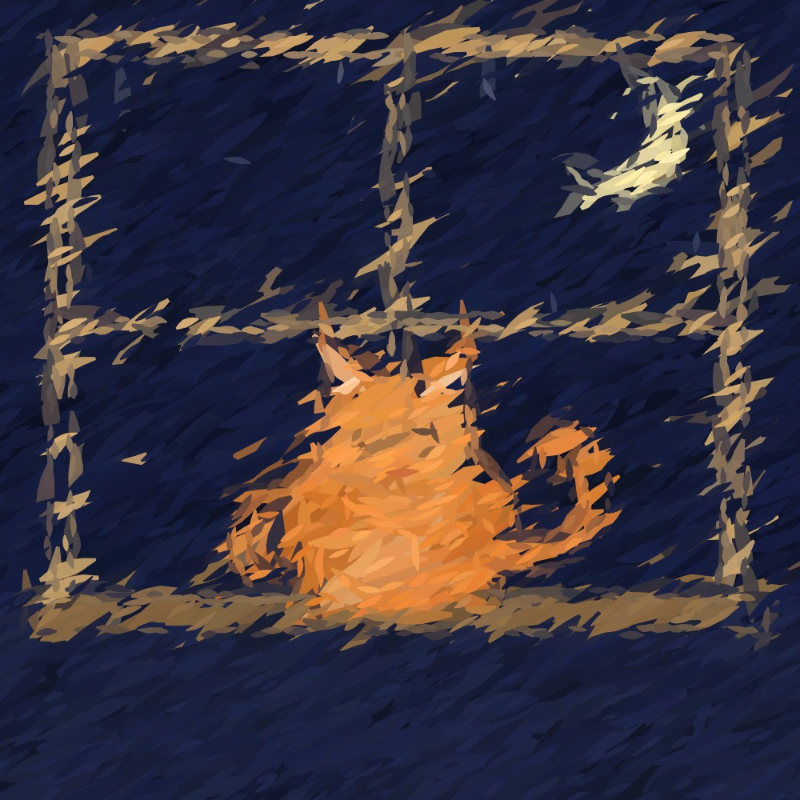
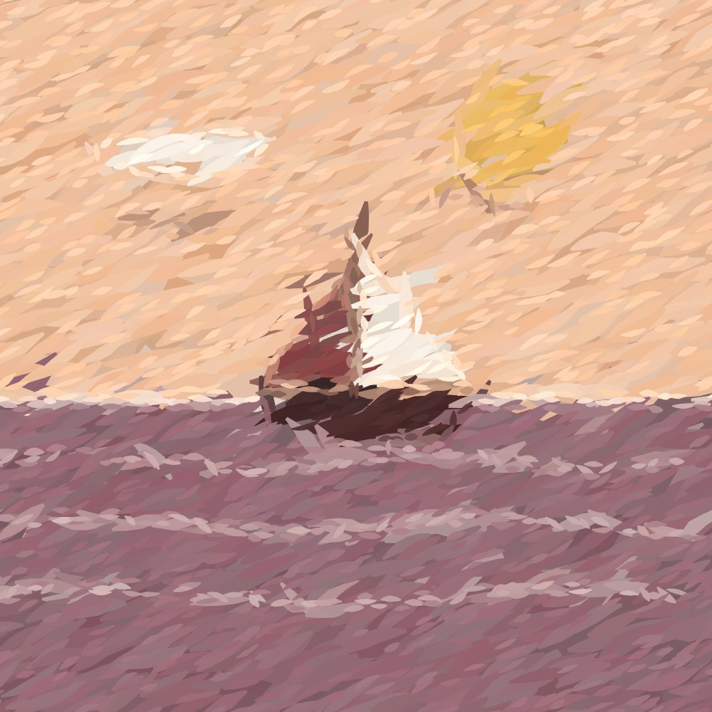
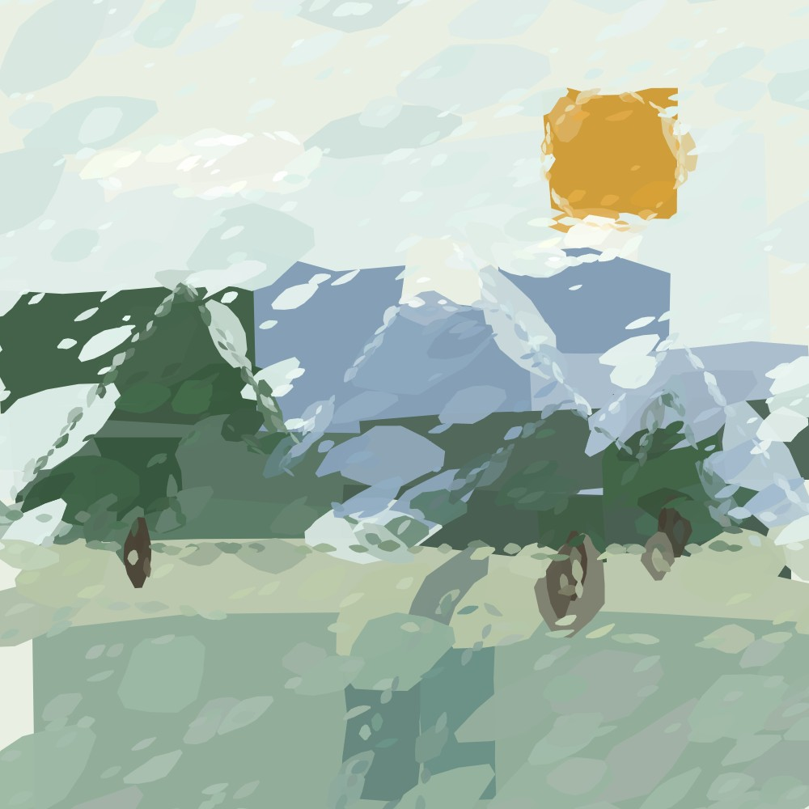
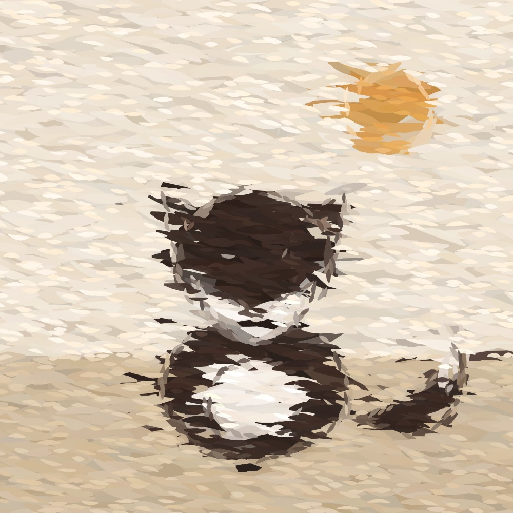
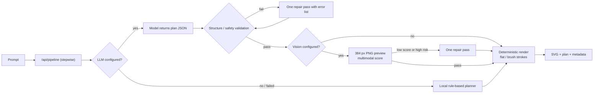
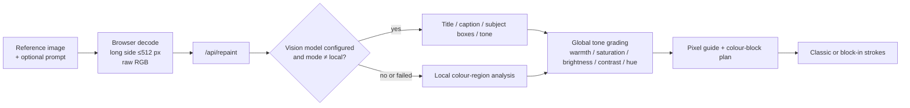

# LMBrush

<a href="./LICENSE"></a>
<a href="https://nodejs.org"></a>


**Natural language → scene plan (JSON) → vector oil painting (SVG).**

LMBrush is a self-contained generative painting studio. A model designs the
composition as a small, validated JSON scene plan; a deterministic renderer
turns that plan into thousands of vector brush strokes. No canvas, no WebGL,
no build step, no runtime dependencies — just Node's built-in HTTP server and
browser-native ES modules.

[简体中文](README.zh-CN.md)



<p align="center"><sub>Actual output — “A ginger cat sitting on a windowsill, starry sky outside.” Classic brush, 3,419 strokes.</sub></p>

## Highlights

- **Plan-first generation.** The model writes a JSON scene plan, not SVG. The
  plan is validated, cacheable, inspectable and editable; invalid output is
  repaired once or rejected before it can reach the renderer.
- **Two oil-painting styles.** *Classic brush* builds layers from underpaint to
  fine detail; *block-in* starts from a few oversized colour fields and refines
  them. Five brush sizes, from hairline to bold.
- **No model required.** Without an LLM the built-in rule-based planner still
  covers common subjects: people, animals, landscapes, cities, night skies,
  flowers and abstract compositions.
- **Reference-image repaint.** Upload a picture; the browser decodes it and
  sends raw RGB. The server builds a pixel guide and repaints it with the same
  brush engine. An optional vision model adds a subject box, title and global
  tone grading.
- **Optional vision critique.** A multimodal model scores a 384 px preview of
  the plan and can trigger one repair pass. Failures never block the image.
- **Prompt enrichment and detail patches.** Expand a short prompt into a richer
  art direction, or ask the model to add local detail to 1–2 focus layers.
- **Zero runtime dependencies.** Hand-written rasteriser, PNG encoder, SVG
  path validator, HTTP server and Vercel adapter. `npm install` is not needed.
- **Deterministic and testable.** The same plan and brush settings always
  produce the same strokes. 146 `node:test` cases cover the pipeline.

## Gallery

<table>
  <tr>
    <td width="50%"><br><sub><b>Fine brush (0.45)</b> · 12,048 strokes · “A short-haired girl with round glasses, warm palette.”</sub></td>
    <td width="50%"><br><sub><b>Classic brush</b> · 3,270 strokes · “A sailboat at sea at sunset, minimalist style.”</sub></td>
  </tr>
  <tr>
    <td><br><sub><b>Block-in</b> · 941 strokes · “A misty valley with distant mountains, pines and a river.”</sub></td>
    <td><br><sub><b>Classic brush</b> · 3,245 strokes · “A fox standing in the snow.”</sub></td>
  </tr>
</table>

Every image above is a real, unedited output. The portrait and sailboat were
rendered by the local planner; the cat used an LLM plan. The SVG files are the
product; the JPEGs here are browser-side rasterisations for this README.

## Quick start

Node 20.6+ is required (`npm run start:env` relies on `--env-file`). There are
no dependencies, so there is nothing to install.

```bash
npm start
# http://127.0.0.1:5174
```

The default port is `5174`; override it with `PORT` and the bind address with
`HOST` (default `127.0.0.1`).

```bash
PORT=5180 npm start          # bash
set PORT=5180&& npm start    # cmd.exe
$env:PORT=5180; npm start    # PowerShell
```

Without an LLM the page runs in local mode and the rule-based planner handles
the prompt. To use a model:

```bash
cp .env.example .env         # fill in LLM_BASE_URL, LLM_MODEL, LLM_API_KEY
npm run start:env
```

`LLM_BASE_URL` points at any OpenAI-compatible `/chat/completions` endpoint —
OpenAI, DeepSeek, Qwen, Moonshot, vLLM, Ollama, or a gateway. Set only
`LLM_BASE_URL` and `LLM_MODEL` to attach a local model without a key.

## How it works



The model owns composition and flat geometry. The renderer owns brush
placement, texture and determinism. The plan is a small contract, so failures
stay in the structure layer and come back with a list of errors the model can
fix.

Rendering is seeded by `hash(brush style + paint style + plan JSON)`: the same
input always yields the same strokes. Plan and render caches are separate, so
switching brush style or size only re-renders — it does not call the model
again. Both caches are in-process and bounded (40 entries).

## Brush styles

The page always outputs oil paintings; the flat renderer remains available
through `/api/generate` (`"render": "flat"`).

| Mode | Brush value | What it does | 1000×1000 output |
|---|---|---|---|
| Classic | `1` | Four layers: blunt underpaint → large mass → shaping → detail | ~3,000–3,700 strokes, ~550–600 KB |
| Classic, fine | `0.45` | Adds a `micro` layer that only paints detected edges | ~11,000–12,000 strokes, ~2 MB |
| Classic, hairline | `0.3` | Shrinks the whole chain again for close-up detail | ~16,000–17,000 strokes, ~3 MB |
| Block-in | `1` | 1–3 oversized colour fields, then progressive refinement | ~800–1,500 strokes, ~150–260 KB |

Classic brush starts from a 192 px colour/lightness guide; block-in uses 256 px;
fine brushes use 384 px (up to 640 px) and hairline 512 px (up to 768 px).
Colours are sampled bilinearly from the guide and nudged in HSL (±2° hue,
±4% saturation, ±4% lightness), so adjacent strokes always differ slightly.
Stroke direction follows the local gradient; flat areas fall back to one flow.

The picture is 100% brush polygons — there is no background rectangle.

## Reference-image repaint

Upload a PNG, JPEG, WebP or GIF; describe the result if you like. The browser
decodes and scales the image, then sends raw RGB bytes (`width × height × 3`,
base64). Nothing is written to disk and the original file is never uploaded.



- The server splits the image into at most 60 colour regions for an inspectable
  plan, but actual strokes sample the **original pixels**. The plan is a
  summary, not a mosaic ceiling.
- `mode`: `auto` (vision first, local fallback), `llm` (require vision, 502 on
  failure), `local` (no model call).
- `tone` is a global grade — warmth, saturation, brightness, contrast and hue
  rotation. It changes colour, never composition or stroke structure.
- Subject boxes from the vision model add up to 700 extra detail strokes
  inside the box (500 for block-in).
- Limits: long side ≤512 px after browser scaling, aspect ratio 1:7.5–7.5:1,
  raw image dimensions 8–768 px, request body ≤4 MB. The page additionally
  rejects files over 20 MB and images over 40 megapixels before decoding.
- Analysis results are cached in memory by image hash + prompt + vision model
  (12 entries). Re-uploading is required to repaint later.

## Detail enrichment

When **Enrich details** is enabled and an LLM is configured, the first plan may
mark 1–2 focus layers. The server computes each layer's real bounding box and
asks the model for a local patch:

1. Patches are validated like any other plan: element type, minimum feature
   size (~0.4% of the short side), inside the focus box, at most 12 elements.
2. The patch becomes a `detail-<layer>` layer after the original, preserving
   occlusion. The global 160-element limit still applies.
3. A failed patch is dropped; the base image is kept and `meta.detail` records
   why. Patches are not re-checked by the vision critic.

## Configuration

Copy `.env.example` to `.env`, or set the same variables in your host.

| Variable | Default | Purpose |
|---|---|---|
| `LLM_BASE_URL` | — | `/v1` root or a full `/chat/completions` URL |
| `LLM_MODEL` | — | Model id |
| `LLM_API_KEY` | — | May be empty for local models |
| `LLM_TEMPERATURE` | `0.8` | Plan temperature |
| `LLM_MAX_TOKENS` | `8000` | Output cap (includes hidden reasoning) |
| `LLM_TIMEOUT_MS` | `120000` | Request timeout; reasoning models need ≥120 s |
| `LLM_MAX_REPAIRS` | `1` | Structure-repair rounds |
| `LLM_JSON_MODE` | `1` | Send `response_format: json_object` |
| `LLM_COMPACT_PLAN` | `1` | Prefer short field names and palette indices |
| `LLM_EXTRA_BODY` | — | JSON merged into the request body |
| `LLM_REASONING_EFFORT` | — | Explicit reasoning level; wins over `LLM_EXTRA_BODY` |
| `LLM_DISABLE` | — | `1` forces local mode |
| `LMBRUSH_STYLE_PACK` | — | Server-default style pack |
| `LLM_PRICE_INPUT` / `LLM_PRICE_OUTPUT` | — | USD per million tokens; enables cost display |
| `VISION_MODEL` | — | Enables vision; must accept `image_url` |
| `VISION_BASE_URL` / `VISION_API_KEY` | `LLM_*` | Separate endpoint or key |
| `VISION_MIN_SCORE` | `75` | Score below which a repair is requested |
| `VISION_MAX_REPAIRS` | `1` | Vision-driven repair rounds (0–2) |
| `VISION_REASONING_EFFORT` | `LLM_REASONING_EFFORT` | Vision reasoning level |
| `VISION_MAX_TOKENS` | `8000` | Vision output cap |
| `VISION_TIMEOUT_MS` | `90000` | Vision request timeout |
| `VISION_REPAIR_TIMEOUT_MS` | `120000` | Repair request timeout |
| `VISION_IMAGE_SIZE` | `384` | Preview PNG long side |
| `VISION_DISABLE` | — | `1` disables the critic |
| `VISION_PRICE_INPUT` / `VISION_PRICE_OUTPUT` | `LLM_PRICE_*` | Separate vision pricing |
| `DEMO_TOKEN` | — | Require a password for all `POST /api/*` |
| `HIDE_MODEL` | Vercel only | `1` hides model ids in every response; `0` shows them |
| `PORT` / `HOST` | `5174` / `127.0.0.1` | Local server bind |
| `LMBRUSH_LOG_PLAN` | — | `0` disables composition logs, `full` prints the plan JSON |

The server reads environment variables only; keys never reach the browser.

## Optional demo gate

Public deployments spend your model credits. Set `DEMO_TOKEN` to require a
password:

```bash
DEMO_TOKEN=<long-random-value>
```

- Every `POST /api/*` requires the token. `GET /api/health` and
  `GET /api/login` stay public.
- Browser flow: open `<site>/api/login?token=<token>&next=/` once; the server
  sets a 30-day `HttpOnly`, `SameSite=Lax` cookie (with `Secure` behind HTTPS)
  and redirects to `next`. `next` only accepts same-site paths.
- Scripts: `Authorization: Bearer <token>` or `x-demo-token: <token>`.
- Missing or wrong token: `401 { "ok": false, "code": "UNAUTHORIZED" }`.
- Leave `DEMO_TOKEN` empty for a fully public instance.

This is a demo gate, not an account system: the token appears in the login
link and is shared by every visitor. Use a long random value and put the
deployment behind platform rate limiting if it is public. Without a token,
anyone can consume model credits.

`HIDE_MODEL` works the same way for model names: Vercel hides them by default
(`VERCEL=1`), local and self-hosted instances show them. `HIDE_MODEL=1` forces
hiding anywhere, `HIDE_MODEL=0` shows names even on Vercel. Redaction happens
while serialising JSON, so the name is absent from the page and the network
payload — not hidden with CSS.

## Plan format

```json
{
  "version": 1,
  "title": "Black cat under the moon",
  "concept": "The cat anchors the lower right; negative space at top left holds the moon. Cool/warm contrast separates the night.",
  "canvas": { "w": 1000, "h": 1000, "background": "#101624" },
  "style": { "preset": "flat", "lineWidth": 0, "outline": null },
  "layers": [
    { "id": "sky", "elements": [
      { "type": "ellipse", "cx": 760, "cy": 220, "rx": 90, "ry": 90, "fill": "#f4e3b2" }
    ]},
    { "id": "cat", "elements": [
      { "type": "path", "d": "M500 625 Q480 650 460 640", "fill": "none", "stroke": "#1a2030", "strokeWidth": 4 }
    ]}
  ]
}
```

Elements: `rect`, `ellipse`, `polygon`, `path`, `line`. `concept` is the
model's one-sentence note about composition choices; the renderer ignores it.

Hard constraints:

- Canvas 256–1000 (reference mode short side ≥128), default 1000×1000.
- At most 12 layers, 60 elements per layer, 160 elements total.
- Polygons have 3–64 points; longer outlines are downsampled evenly, keeping
  the first and last vertex.
- Colours are `#rgb`, `#rrggbb` or `none`.
- `path.d` only allows `M L H V C S Q T A Z` (either case), with validated
  argument counts, coordinate ranges and arc flags.
- No `text`, scripts, event attributes, filters or external references.
- With `LLM_COMPACT_PLAN=1` (default) the prompt prefers short field names and
  palette indices; `normalizePlan` expands them before validation. Known
  ambiguities (`t:"p"` with only `d` → path, ellipse `r:[rx,ry]`) are fixed
  first.

Validation runs on the server, and the renderer only serialises validated
fields — model output cannot inject arbitrary markup.

## Style packs

Five palette/mood presets are included. They contribute colours and a mood
phrase only; typography, spacing and layout rules are discarded.

| id | Mood |
|---|---|
| `claude` | Warm cream, terracotta, teal accents; editorial warmth |
| `linear` | Near-black, light grey, one lilac accent; precise and technical |
| `stripe` | White, indigo, cream and magenta; restrained gradients |
| `spotify` | Near-black with one green accent; content first |
| `apple` | White/parchment with one blue accent; minimal and product-led |

Choose one in the page, with `"stylePack": "claude"`, or set
`LMBRUSH_STYLE_PACK`. Packs only affect LLM prompts; local mode ignores them.
Explicit colours from the user always win.

The palettes are derived from
[VoltAgent/awesome-design-md](https://github.com/VoltAgent/awesome-design-md)
(MIT). See [THIRD_PARTY_NOTICES.md](THIRD_PARTY_NOTICES.md).

## Vision critique

Set `VISION_MODEL` to enable it. Each LLM generation then:

1. Rasterises the plan to a 384 px PNG preview with the built-in encoder.
2. Sends it as an `image_url` data URI with the rubric in `prompts/critic.md`.
3. If `score < VISION_MIN_SCORE` or any issue is `high`, sends the critique
   back for one repair pass. The repaired plan must pass validation or the
   original is kept.

The critic sees the **flat plan preview**, not the brush layer. Extremely fine
strokes can smear ears or tails while the score stays high. Scores are noisy,
so use them as a gate, not an absolute quality metric. `VISION_DISABLE=1` or an
empty `VISION_MODEL` removes the step entirely; a failed vision call never
blocks the image.

## HTTP API

With `DEMO_TOKEN` set, every `POST` needs the token as described above.

### `GET /api/health`

Reports `ok`, auth state, whether LLM and vision are configured, available
style packs and the Node version. Secrets are never returned; model ids are
redacted when hiding is active.

### `POST /api/enrich`

```json
{ "prompt": "a cat", "nonce": 1710000000000 }
```

Expands a short prompt into a richer art direction. Text only; no image and no
generation cache. Requires an LLM (503 otherwise). Output is capped at 600
characters. The optional `nonce` makes repeated clicks produce different
directions.

### `POST /api/repaint`

```json
{
  "prompt": "optional title or caption",
  "mode": "auto",
  "paintStyle": "classic",
  "brush": 1,
  "variant": 0,
  "image": { "w": 512, "h": 384, "data": "<base64 RGB>" }
}
```

`image.data` is raw RGB, not a file: `w × h × 3` bytes, row-major. A
`data:image/...;base64,` prefix is tolerated, but the server does not decode
PNG/JPEG. `mode` is `auto`, `llm` or `local`; `paintStyle` is `classic` or
`blockin`; `brush` is 0.3–1.8; `variant` is 0–999. Style packs, presets and
detail enrichment are ignored in this mode. The response has the same shape as
`/api/generate`, plus `meta.reference` (regions, subject boxes, analysis
source), `meta.tone` and `meta.toneSource`.

### `POST /api/generate`

One-shot compatibility endpoint. The page uses `/api/pipeline` instead, because
a single request can approach Vercel's 300 s limit when every optional stage is
enabled.

```json
{ "prompt": "a ginger cat, starry night", "style": "flat", "mode": "auto",
  "render": "paint", "paintStyle": "blockin", "brush": 1,
  "variant": 0, "stylePack": "claude", "detail": false }
```

- `style`: `auto`, `flat`, `line`, `gradient`, `minimal`
- `mode`: `auto` (LLM, fall back to local), `llm`, `local`
- `render`: `paint` (default) or `flat` (API only)
- `paintStyle`: `classic` or `blockin`
- `brush`: `0.3` hairline, `0.45` fine, `0.8` fine-detail, `1` standard,
  `1.35` bold
- `detail`: enable local detail patches (LLM only, 1–2 extra calls)
- `variant`: 0–999; increments bypass the cache and produce a new composition

The response carries `plan`, `svg` and `meta` (`mode`, `model`, `ms`,
`strokes`, `paintStyle`, per-stage timings, `advisories`, `aesthetic`,
`critique`, `criticRepair`, `detail`, `usage`, `cost`). `meta.advisories` are
diagnostics only: they never trigger repairs and never block rendering. With
prices configured, `meta.cost` breaks input/output tokens and USD amounts down.

### `POST /api/pipeline`

The page splits generation into independent requests so no single function
accumulates planning, critique, repair, detail and rendering in one 300 s
window. The plan travels through the browser and is re-validated on every
step.

| step | Request fields | Response |
|---|---|---|
| `plan` | `prompt`, `style`, `mode`, `variant`, `stylePack`, `detail` | `plan`, `focus`, `meta` |
| `render` | `plan`, `render`, `paintStyle`, `brush`, `variant` | `svg`, `meta` |
| `critique` | `plan`, `prompt`, `stylePack` | `critique`, `repair`, `meta` |
| `repair` | `plan`, `critique`, `prompt`, `style`, `stylePack` | `plan` or `null`, `applied`, `meta` |
| `detail` | `plan`, `prompt`, `focus`, `style`, `stylePack` | `plan` or `null`, `applied`, `meta` |

Each step has a 260 s internal budget, below Vercel's hard 300 s limit. The
request body limit is 1 MB (plans can be a few hundred KB). `critique` returns
503 without a vision model; `repair` and `detail` return 503 without an LLM.
A rejected patch yields `plan: null` / `applied: false`; the client keeps the
base image.

## Deploy to Vercel

Vercel's zero-config Node entry is `server.ts` at the root. This project uses
`server.js` for local and self-hosted use, so the repository ships an `api/`
adapter layer that forwards requests to the same handler. `public/` is served
as static output.

1. Import the repository on Vercel and choose **Other** as the framework.
2. Leave Build Command empty; Output Directory is `public` (declared in
   `vercel.json`).
3. Add `LLM_BASE_URL`, `LLM_MODEL`, `LLM_API_KEY` and optional `VISION_*`
   variables under Project Settings → Environment Variables. Never commit
   `.env`.
4. Set `DEMO_TOKEN` for a public demo; open `<site>/api/login?token=<token>`.
5. Deploy. `/api/health` returning `ok: true` confirms the wiring.

Platform limits (Vercel docs, 2026-08):

- Request and response bodies are capped at **4.5 MB**. A 1000 px classic
  painting is ~550–600 KB of SVG; fine brush is ~2 MB and hairline ~3 MB.
  Avoid the smallest brushes with many layers.
- Hobby functions run for at most **300 s**. The stepwise pipeline uses 260 s
  per step; `/api/repaint` uses 280 s internally.
- **Set `DEMO_TOKEN` on public deployments.** Every POST can spend model
  credits. A Vercel domain is public by default.
- Hobby is for non-commercial use; commercial use requires Pro.
- Caches live in the function instance and are not shared across instances;
  they are lost on cold start.
- Vercel defaults to Node 26. If the upstream model endpoint has trouble with
  Node 26 HTTP/2 `fetch`, set `VERCEL_FETCH_DISABLE_H2=1` and redeploy.

For long connections, large SVGs or a persistent cache, run `npm start` on a
VPS, Render, Railway or Fly.io — the `api/` adapters are not needed there.

## Testing and evaluation

```bash
npm test                    # paths, plan, render, brush, reference, planner, HTTP, LLM pipeline
npm run eval                # 20 local-mode prompts → eval/report.json
node eval/run.js --llm      # same set against a real model
node eval/run.js --paint    # evaluate classic oil output
node eval/run.js --blockin  # evaluate block-in output
```

`npm test` uses `scripts/hermetic-env.mjs` to strip inherited `LLM_*` and
`VISION_*` variables, so a developer's `.env` cannot make tests order-dependent.
The suite is 146 cases and runs in about 1.5 s on Node 24. CI runs it on Node
20, 22, 24 and 26.

The evaluation reports validity rate, average and P95 latency, average element
count and SVG size.

## Project layout

```text
core/
  path.js            SVG path structure validation
  path-geometry.js   path → polylines (curves and arcs flattened)
  schema.js          plan contract, compact aliases, defaults, validation
  aesthetics.js      composition audit (neck length, round heads, palette, contrast)
  render.js          plan → flat SVG
  raster.js          plan → colour guide (built-in software rasteriser)
  reference.js       reference pixels → colour-block plan / pixel guide
  paint.js           plan/guide → classic or block-in strokes → oil SVG
  color.js           HSL sampling and jitter
  tone.js            global tone grading and pixel/plan remapping
  png.js             zero-dependency RGB PNG encoder
  preview.js         plan → 384 px preview PNG for the critic
  local-planner.js   rule-based planner used without an LLM
server/
  llm.js             OpenAI-compatible client, JSON extraction, repair loop
  generate.js        orchestration, caches, fallback, composition logs
  reference.js       repaint orchestration, vision parsing, memory cache
  enrich.js          prompt enrichment (explicit user action)
  style-packs.js     pack loading, validation, prompt formatting
  vision.js          multimodal critique, score normalisation, repair
  pipeline.js        stepwise orchestration (plan/render/critique/repair/detail)
server.js            HTTP server and static assets
api/
  generate.js        Vercel function: /api/generate (one-shot)
  pipeline.js        Vercel function: /api/pipeline (stepwise)
  repaint.js         Vercel function: /api/repaint
  enrich.js          Vercel function: /api/enrich
  health.js          Vercel function: /api/health
  login.js           Vercel function: /api/login (optional token gate)
server/vercel.js     request adapter shared with the local server
vercel.json          static output and function configuration
prompts/system.md    JSON protocol and technical constraints
prompts/enrich.md    prompt-enrichment instructions
prompts/critic.md    vision rubric
prompts/reference.md reference-image analysis instructions
prompts/style-packs.json  palettes (derived from awesome-design-md, MIT)
public/              single-page UI
docs/images/         README screenshots
test/                node:test cases
eval/                prompts and batch evaluation
```

## Design decisions

- **The model does not write SVG.** SVG is code: hard to diagnose, hard to
  validate, impossible to cache safely. A plan contract confines failures to
  the structure layer and produces a fixable error list.
- **Prompts stay technical.** The generation prompt defines the JSON contract,
  element fields and renderer facts. It does not inject taste rules,
  proportions, composition advice or complete examples. Content is the model's
  decision.
- **Aesthetics are diagnostics.** `aesthetics.js` writes extreme measurements
  to `meta.advisories`; it never generates, repairs or blocks.
- **Silhouettes are a readability tool, not a rule.** Models may use closed
  paths, stacked shapes, geometric splits or abstraction.
- **Style packs migrate colour, not layout.** Typography, spacing, components
  and grids are irrelevant to a single painting; only seven colours and a mood
  phrase are injected.
- **Vision is optional.** It reads a 384 px flat preview; it is a gate, not part
  of generation. Bad scores can be ignored or repaired; failures keep the image.
- **Reference images are not hallucinated.** Pixels drive composition and base
  colours. The vision model only contributes title, caption, subject boxes and
  tone. Wrong coordinates can misplace detail strokes; tone only changes colour.
- **The browser decodes images.** Node has no image codec, and adding one would
  break the zero-dependency promise. Only raw RGB bytes are uploaded.
- **The local planner is a fallback.** It covers common subjects; long-tail
  requests need an LLM.
- **At most 2–3 model calls** in the base flow: plan, optional critique, one
  repair. Detail enrichment adds 1–2 local patches. There is no multi-agent
  conversation loop.
- **Zero dependencies.** No build chain, framework or drawing library. The
  guide image comes from a built-in software rasteriser; no canvas/WebGL.
- **Deterministic strokes.** The same plan and paint style always produce the
  same strokes, which makes caching and regression tests possible.
- **Plan and render caches are separate.** Switching style or brush size never
  re-spends LLM tokens.

## Known limitations

- Plans are geometric: no photographic texture, complex lighting or detailed
  character design.
- Composition quality depends on the model. Validation only guarantees
  legality; the aesthetic audit only catches extreme, measurable cases.
- Free-form paths depend on model skill. The system prompt provides no complete
  picture example, so a model may repeat its own defaults; the audit will not
  block those choices.
- The vision critic sees a 384 px flat plan preview, not the brush layer.
  Details lost to strokes can still score well.
- Vision scores are noisy; calibrate `VISION_MIN_SCORE` per model.
- Classic mode uses a 192 px guide (block-in 256 px). Eyes and text are
  approximate. A 1000×1000 classic painting is ~3,000–3,700 strokes and
  ~550–600 KB of SVG; block-in is ~800–1,500 strokes and ~150–260 KB.
- Detail patches depend on the first plan and the 160-element cap. If the model
  did not separate the subject into its own layer, the server falls back to the
  largest non-background layer, which may not be where you wanted detail.
- Block-in is more abstract: large fields survive, details outside edges may be
  simplified. It is not a higher-fidelity mode than classic.
- Strokes come from guide sampling plus HSL jitter; there is no pigment mixing,
  impasto lighting or canvas texture.
- The flat renderer supports only global gradient overlays, not per-element
  gradients.
- Reference images are scaled to 512 px on the long side in the browser, so
  finer source detail never reaches the pixel guide.
- Reference repaint does not semantically reconstruct the scene; it preserves
  composition. Subject boxes only add local detail strokes.
- Reference mode ignores style presets, style packs and detail enrichment.
  Tone grading is global, not per-region.
- Reference analysis is in-process (12 entries) and lost on restart; original
  files are not stored. History keeps only the generated SVG, plan and
  metadata.
- Reference inputs wider than 7.5:1, longer than 768 px per side or over 4 MB
  are rejected.

## FAQ

**Why does the same prompt sometimes give the same image?**

Four caches/seeds are involved: plan cache (prompt + style + mode + variant +
style pack + vision + detail), render cache (plan + render + paint style +
brush), the deterministic stroke seed, and the local planner's deterministic
seed. The page increments `variant` on every generate, which bypasses the plan
cache. API callers must increment `variant` themselves for a new composition.

**“LLM response missing content” / automatic fallback**

Reasoning models can spend the entire completion budget on hidden reasoning,
returning `finish_reason=length` with empty `content`. The client retries with
1.75× `max_tokens` up to 16,000, then asks you to raise `LLM_MAX_TOKENS` or use
a non-reasoning model. If `finish_reason` is not `length`, the upstream response
probably does not match OpenAI `/chat/completions`; check `LLM_BASE_URL`.

**The two fallback messages are different**

- `LLM call failed, fell back to local rules: …` — the request did not go
  through (connection, timeout, HTTP error, non-JSON or empty body).
- `LLM plan failed validation, fell back to local rules: …` — the model
  answered, but the plan violated the contract. `meta.llmErrors` has the full
  list.

**How much does a generation cost?**

One successful generation is one model call by default; vision makes it two and
a repair makes it three. Token usage is roughly: system prompt 1–2k, hidden
reasoning 3–5k, plan 2–3k; critique 1–2k; repair 3–4k; detail 1–3k per region.
`meta.usage` and, with prices configured, `meta.cost` report the exact numbers
per step.

## License

LMBrush is licensed under the **GNU General Public License v3.0 or later**.
See [LICENSE](LICENSE). Copyright (c) 2026 x177plus.

`prompts/style-packs.json` contains colour palettes and mood words derived from
[VoltAgent/awesome-design-md](https://github.com/VoltAgent/awesome-design-md)
(MIT). The upstream license and attribution are in
[THIRD_PARTY_NOTICES.md](THIRD_PARTY_NOTICES.md). Claude, Linear, Stripe,
Spotify, Apple and other product names are trademarks of their respective
owners; the style pack ids describe palette mood only, and this project is not
affiliated with or endorsed by those companies.

Generated SVG/PNG files are yours to use. When you call a third-party model,
its terms also apply to the input and output.