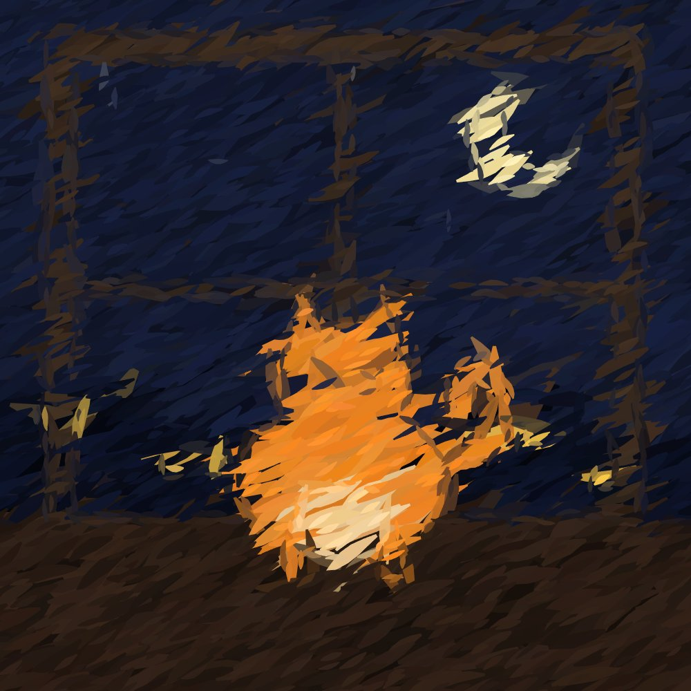
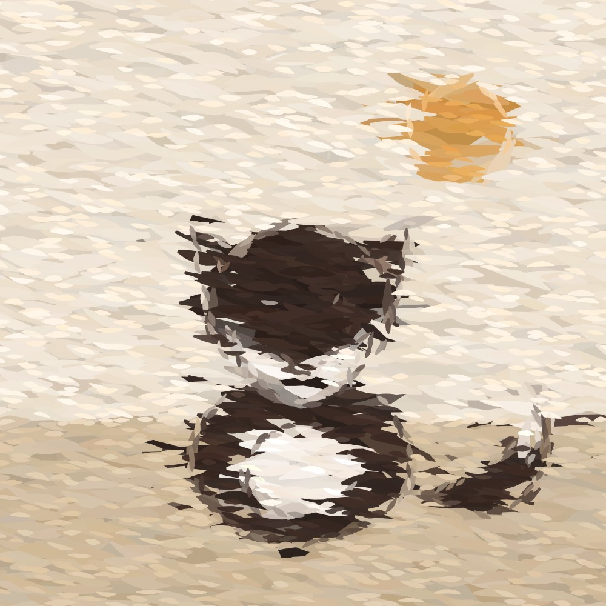
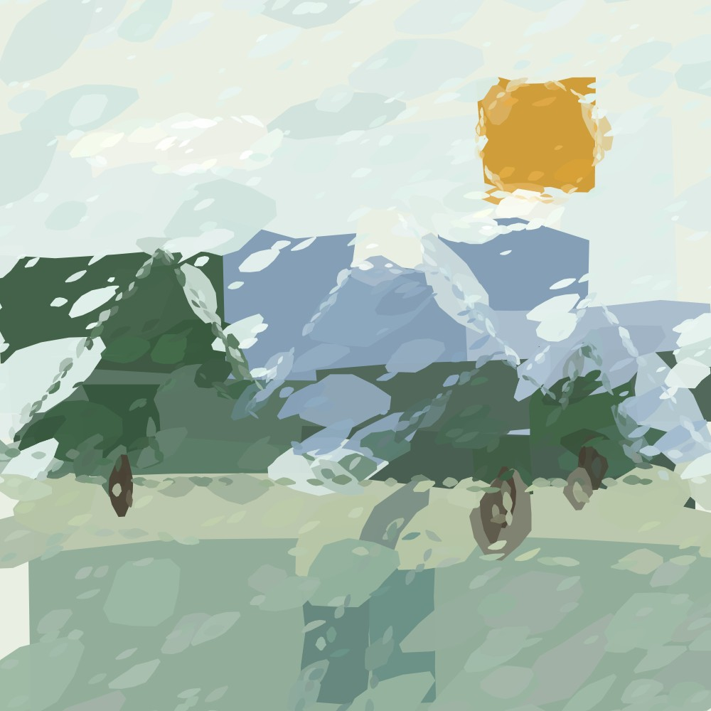
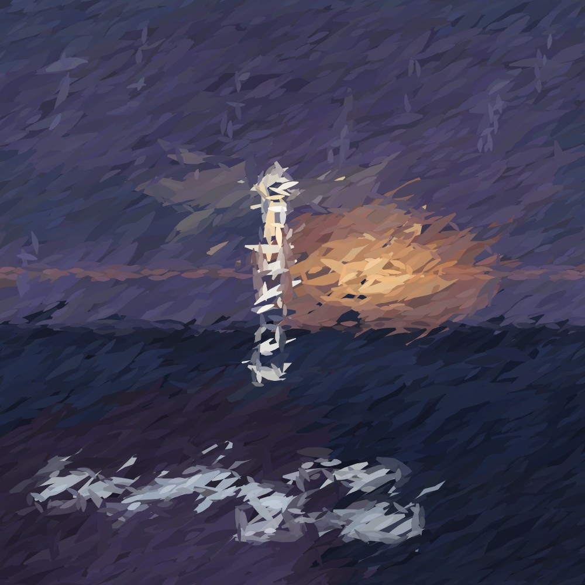
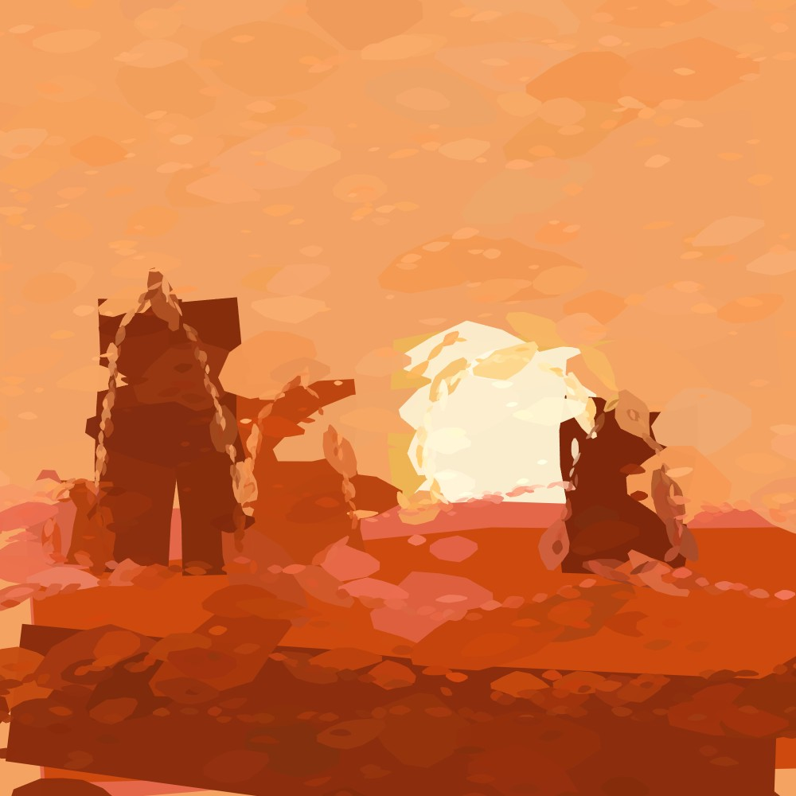
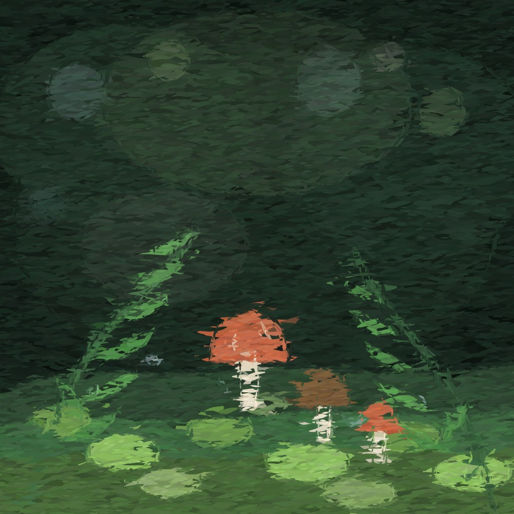
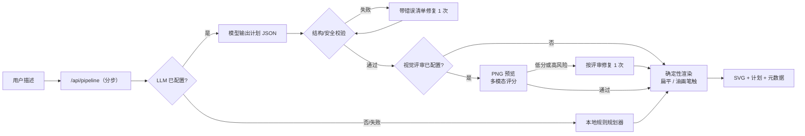
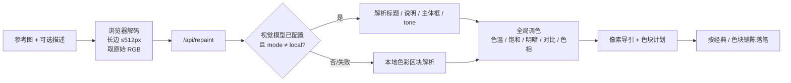

# LMBrush

<a href="./LICENSE"></a>
<a href="https://nodejs.org"></a>


**自然语言 → 绘制计划（JSON）→ 矢量油画（SVG）。**

[English](README.md) · 简体中文



<p align="center"><sub>真实输出——“一只橘猫坐在窗台上，窗外是星空”，经典笔触。</sub></p>

支持两种介质：**扁平色块**，以及完全由笔触组成的**油画**。油画又分两种笔触风格：**经典笔触**与**色块铺陈**。还可以上传一张**参考图**，用同一套笔触方案解析并重绘它；描述可留空，也可以用来做整体调色（暖/冷、黑白、明暗、对比），构图不变。零运行时依赖：Node 内置 HTTP、纯 JS 渲染器、浏览器原生 ES 模块。

<table>
  <tr>
    <td width="50%"><br><sub><b>经典笔触</b> · 3270 笔 · “日落时的海边帆船，极简风格。”</sub></td>
    <td width="50%"><br><sub><b>经典笔触</b> · 3245 笔 · “一只狐狸站在雪地里。”</sub></td>
  </tr>
  <tr>
    <td><br><sub><b>色块铺陈</b> · 941 笔 · “晨雾中的山谷，远山、松树和一条河。”</sub></td>
    <td><br><sub><b>经典笔触</b> · 3321 笔 · “海边悬崖上的白色灯塔，暴风雨前的黄昏，海浪拍岸。”</sub></td>
  </tr>
  <tr>
    <td><br><sub><b>色块铺陈</b> · 912 笔 · “沙漠中的红色岩石和落日，极简构图。”</sub></td>
    <td><br><sub><b>极细笔触（0.45）</b> · 13011 笔 · “雨后的森林，苔藓、蕨类和蘑菇，微距感。”</sub></td>
  </tr>
</table>

以上均为真实输出，未做后期处理；帆船、山谷和狐狸由本地规则规划器生成，橘猫、灯塔、沙漠和森林使用 LLM 计划。产品是 SVG，README 中的 JPEG 是浏览器栅格化后的展示图。



模型负责画面设计与平面几何（JSON），渲染器负责笔触、纹理和确定性输出（SVG）。计划是可校验、可缓存、可手改的 JSON，不是模型直接吐出的 SVG。

## 快速开始

需要 Node 20.6+（`npm run start:env` 依赖 `--env-file`；无 npm 依赖，不需要 `npm install`）。

```bash
npm start
# http://127.0.0.1:5174
```

默认端口是 `5174`，被占用时用 `PORT` 覆盖：PowerShell `$env:PORT=5180; npm start`，cmd `set PORT=5180&& npm start`，bash `PORT=5180 npm start`。监听地址用 `HOST` 覆盖（默认 `127.0.0.1`）。

不带 LLM 时会走本地规则规划器，覆盖常见人物、动物、风景、城市、星空、花卉和抽象主题。

页面固定输出**油画**，可在“经典笔触”和“色块铺陈”之间切换，笔触大小可选**纤毫 / 极细 / 细腻 / 标准 / 粗犷**；整幅画面仍由笔触多边形组成，不提供扁平/油画介质切换。**丰富细节**开关默认关闭；打开后，首轮规划会标记 1–2 个主要物体，再由 LLM 分别追加局部细节补丁，适合“沙发、脸、植物”这类需要近看的内容。切换笔触风格或笔触大小后点“生成画面”，会复用当前构图、只换笔触；要换构图，再点一次“生成画面”或点“换一张”。接口仍保留缓存，固定参数会返回同一结果。

输入框右上角的**润色描述**按钮会让 LLM 把当前原文扩展成更具体的画面提示，并随机选择一个视觉方向（视角、光线、构图、材质或情绪）。每次点击都从原文重新抽卡，结果写回输入框；可以继续修改后再生成，也可以点“恢复原文”回到未润色的描述。不点润色时，生成直接使用你输入的原描述。未配置 LLM 时按钮隐藏。

## 部署到 Vercel

Vercel 的零配置 Node server 入口是根目录（或 `src/`）的 `server.ts`；本项目是 `server.js`，直接导入时按当前文档只会把 `public/` 当静态站点。仓库因此提供了 `api/` 适配层（含 `api/pipeline.js`），复用同一个请求处理器，`server.js` 继续用于本地和自托管。静态页面由 Vercel 从 `public/` 提供。

页面默认把生成拆成 `plan → render → critique/repair → detail → render` 多次请求，每步单独占用一个函数调用，避免把计划、视觉评审、修复和细节补丁累计到同一个 300s 窗口。`/api/generate` 仍保留为一次性的兼容接口，但它可能累计超时。首轮渲染后会先用逐笔回放展示绘制过程（默认 120 批、约 12 秒，按批次数自适应）：回放期间状态条显示“生成中 · Xs”，回放结束而流程未结束时切换为“评审中 · Xs”（只启用细节时为“补充细节中”）。如果评审失败、或评审/细节没有改变画面，回放会继续到结束，最终图不会因为评审失败被替换或隐藏；如果修复或细节补丁生成了新画面，会立即停止回放并切换到新图。全部请求结束后显示下载按钮，回放可能仍在继续，但不影响下载。

1. 在 Vercel 导入 GitHub 仓库，Framework Preset 选择 **Other**（无框架时默认就是它）。
2. Build Command 留空，Output Directory 为 `public`（`vercel.json` 已声明）。
3. 在 Project Settings → Environment Variables 填入 `LLM_BASE_URL`、`LLM_MODEL`、`LLM_API_KEY`；需要视觉评审或参考图解析时再加 `VISION_*`。不要把 `.env` 提交或上传。
4. 公开演示再设 `DEMO_TOKEN`（可选，见下文“访问口令”）；留空则接口完全公开。设置后把 `<站点>/api/login?token=<口令>` 发给访问者。模型名在 Vercel 部署中默认隐藏；要在部署版显示，设 `HIDE_MODEL=0`。
5. Deploy。`/api/health` 返回 `ok:true` 即接通。

平台限制（Vercel 2026-08 文档）：

- **页面已改为分步请求**：`/api/pipeline` 的 plan/render/critique/repair/detail 各自独立，单请求不再累计计划 + 评审 + 修复 + 细节；每步内部预算 260s。`/api/generate` 仍是一次性兼容接口，开启所有可选项时仍可能接近 300s。参考图重绘仍走 `/api/repaint` 单次请求（内部预算 280s）。
- 函数请求体和响应体上限 **4.5 MB**。画布上限 1000px；实测 1000px、5 层计划下，极细笔触 SVG 约 2.2 MB、纤毫约 3.2 MB（含 JSON 包装约 3.3 MB），仍在限制内；图层特别多时建议避免最细笔触。参考图请求体本身也受 4 MB 限制。
- Hobby 函数最长 **300 秒**，默认也是 300 秒；分步后每步有独立的 260s 预算。`/api/generate` 一次性路径仍建议设 `VISION_MAX_REPAIRS=0` 或 `LLM_MAX_REPAIRS=0`。
- **公开部署请设 `DEMO_TOKEN`**：设置后所有 `POST /api/*` 都要求口令；`/api/pipeline` 的 `plan` / `critique` / `repair` / `detail`、`/api/generate`、`/api/enrich`、`/api/repaint` 都会消耗服务端模型密钥。Vercel 部署域名默认公开，别把带密钥的 demo 无口令暴露给所有人；不设口令就完全公开。
- Hobby 仅限非商业用途；商用需要 Pro。
- 计划/渲染缓存是进程内缓存，不跨函数实例共享，冷启动后失效。
- Vercel 当前默认 Node 26。若上游模型端点对 Node 26 的 HTTP/2 `fetch` 不兼容，设 `VERCEL_FETCH_DISABLE_H2=1` 后重新部署。
- 前端仍受 4 MB 的 `/api/repaint` 请求体限制；页面端的 20 MB 文件限制不会改变平台上限。

### 部署在二级目录

前端资源和 API 都使用相对路径，因此同一份代码既能在域名根路径运行，也能放在 `https://app.177.plus/LMBrush/` 这类子路径下。Vercel 的项目只能绑定域名根，所以要在**持有 `app.177.plus` 的父项目**里把路径代理到本项目的部署：

```json
{
  "redirects": [
    { "source": "/LMBrush", "destination": "/LMBrush/", "permanent": false }
  ],
  "rewrites": [
    { "source": "/LMBrush/", "destination": "https://<lmbrush-deployment>.vercel.app/" },
    { "source": "/LMBrush/:path*", "destination": "https://<lmbrush-deployment>.vercel.app/:path*" }
  ]
}
```

- 这些规则要放在父项目任何 catch-all rewrite 之前。
- 末尾斜杠的重定向不能省：`styles.css` 和 `api/health` 都是相对当前文档 URL 解析的。
- 登录链接要带前缀和登录后路径：
  `https://app.177.plus/LMBrush/api/login?token=<口令>&next=/LMBrush/`
- 不要把 `/LMBrush` 的 rewrite 加到本项目自己的 `vercel.json`：本项目部署在根路径，由父项目剥掉前缀。
- 非 Vercel 的反向代理同理：转发前剥掉 `/LMBrush`，并把 `/LMBrush` 重定向到 `/LMBrush/`。

不想受 Serverless 限制（长连接、超大 SVG、常驻缓存）时，用 Render / Railway / Fly.io / 自有 VPS 跑 `npm start` 即可；`server.js` 不需要 `api/` 适配层。

## 油画笔触是怎么来的

1. 计划先用内置软件光栅器渲染成一张颜色/明暗导引图（支持 rect、ellipse、polygon、path、line 与透明度）。经典模式用 192px 长边，色块铺陈用 256px；极细笔触改用 384px 起（画布更大时最多 640px）、纤毫改用 512px 起（最多 768px）的导引图，并用双线性采样避免小笔触取到模糊的邻域颜色。
2. 每一笔的位置、长度、宽度、角度、弯曲度都由种子随机决定，颜色从导引图采样或从计划图元取填充色。
3. 颜色做小幅 HSL 抖动（色相 ±2°、饱和度 ±4%、明度 ±4%），所以相邻笔触总有细微色差。
4. 笔触方向优先沿局部梯度（形体走向），平坦区域退化为统一流向；画面 100% 由笔触多边形组成，没有底色矩形。

### 经典笔触

标准大小固定四层：钝头底色 → 大笔铺陈 → 中笔塑形 → 小笔刻画。每层覆盖整张画布，detail 层在平坦区域只保留 25%。1000×1000 画布约 3000–3700 笔，SVG 约 550–600 KB。

**极细**在此基础上追加一层 `micro` 笔触：只在 384px 导引图检测到边缘的位置落笔，笔宽约 1.8–3.2px，长度 5–11px，用来保留眼睛、胡须、叶脉一类小结构。为控制体积，笔触间距不会随笔宽等比例缩小；1000×1000 画布约 1.1–1.2 万笔，SVG 约 2 MB，适合需要近看细节的画面。

**纤毫**把整条笔触链再缩小一档：导引图从 512px 起，基础笔宽约为基础层的 0.3 倍（detail 约 2.1–3.3px，micro 约 1.2–2.1px、长 3.6–7.2px）。1000×1000 画布约 1.6–1.7 万笔，SVG 约 3 MB；高频细节参考图最多 2.4 万笔（超出时截断 micro 层），保证计划 + SVG 响应仍低于平台 4.5 MB 上限。适合人脸、花瓣、织物等需要贴近观看的画面，导出和传输也更重。

### 色块铺陈

先从计划里最大的非背景填充图元播种 1–3 笔巨幅色块，最大笔宽约为画布短边的 20%–45%；再按“大笔铺陈 → 中笔塑形 → 小笔细节”逐层细化。后四层在平坦区域只保留 5%–32% 的笔触，边缘始终保留，所以大色块不会被小笔完全盖掉。没有可用大图元时（线稿、极小图元），回退到导引图采样的巨笔。

1000×1000 画布通常约 800–1500 笔，SVG 约 150–260 KB；视觉上更概括、色块更明显，适合强调构图和体块而不是细节。页面同时提供 PNG 导出（浏览器端栅格化）。

### 丰富细节（可选，仅 LLM）

打开“丰富细节”后，一次生成会多出 1–2 次局部补丁调用：

1. 首轮规划要求模型把主要物体放进独立图层，并在计划根对象返回 `focus`（最多 2 个图层 id）。例如用户说“一张沙发”，模型可能返回 `focus:["sofa"]`。
2. 服务端从该图层的真实图元计算 bbox，不用模型猜坐标；然后把 bbox、现有图元和配色发给 LLM。
3. 每个区域返回一个 `{"elements":[...]}` 局部补丁。服务端校验图元合法性、最小特征尺寸（约画布短边的 0.4%，1000px 画布约 4px）、是否落在目标框内，并限制为 12 个图元。
4. 补丁作为 `detail-<layer>` 图层插在原图层之后，保留前后遮挡；总图元仍受 160 个上限约束。
5. 任何补丁失败都只丢弃该补丁，保留基础画面，`meta.detail` 记录失败原因。

细节补丁发生在视觉评审和修复之后，所以不会因为评审修复而丢失；反过来，视觉评审也看不到最终细节层。它最适合搭配**纤毫 / 极细 / 细腻**笔触，标准笔触会把小细节盖掉。本地模式或不配置 LLM 时开关不可用，接口会返回未应用原因。

## 参考图重绘（可选）

页面顶部的“参考图（可选）”支持浏览器能解码的图片（PNG、JPEG、WebP、GIF 等）。上传后描述可以留空，点“重绘参考图”就会得到一张由同一套油画笔触组成的 SVG。



1. 浏览器负责解码和缩放，只把 `width × height × 3` 的原始 RGB 字节（base64）发给服务端。Node 端没有图片编解码器；上传的图片不落盘、不进入历史记录，也不写缓存文件。
2. 服务端把像素按颜色方差切成最多 60 个矩形区块，生成一份合法、可展开查看的计划 JSON。画布保持参考图长宽比：长边固定 1000，短边按比例缩放（最低 128）。
3. 真正的笔触颜色和边缘来自**原始像素导引图**，不是 60 个色块的马赛克。所以笔触会跟随原图的渐变、光影和主体轮廓；计划 JSON 只是这次解析的可读摘要。
4. 配置了 `VISION_MODEL` 且 `mode` 不是 `local` 时，服务端会把同一张图（384px PNG）和可选描述发给多模态模型，返回标题、说明、0–3 个归一化主体框和可选的 `tone` 调色参数。主体框内会追加细节笔触：经典最多 700 笔，色块铺陈最多 500 笔，用来保住脸、眼睛、花、文字等小结构。视觉调用失败只回退到本地解析并写入 `meta.warning`；`mode=llm` 时才返回 502。
5. `tone` 非中性时，服务端在落笔前把同一组参数应用到像素导引和计划色块：区块坐标、构图和笔触结构不变，只有颜色变化。视觉模型没给 `tone` 时，本地关键词解析兜底。
6. `mode=local` 完全跳过视觉解析，本地解析通常在 1 秒内完成。`mode=auto` 优先视觉解析，失败回退本地；`mode=llm` 要求视觉模型可用。
7. AI 解析结果按“图片哈希 + 描述 + 视觉模型”缓存在内存里（最多 12 条）。切换“经典 / 色块铺陈”或笔触大小只重新落笔，不会再次调用视觉模型；改描述会重新解析。页面会显示“解析缓存”。
8. 参考图模式下，风格预设、配色包和“丰富细节”不参与：颜色来自图片和 `tone`，色块计划也不需要 LLM 局部补丁。页面会禁用这些控件，而不是静默忽略。
9. 限制：长边缩放上限 512px，长宽比需在 1:7.5–7.5:1 之间，单文件最多 20 MB；页面会在解码前读取文件头，超过 4000 万像素的图片直接拒绝。接口请求体最多 4 MB。参考图本身不存进 `localStorage` 历史记录；历史里只保留生成的 SVG、计划和元数据。

描述在参考图模式下不再只是题注：视觉解析用它决定标题/说明/主体框，并生成 `tone`；本地解析会识别常见色调词。调色只做整张图的色彩分级，不做局部改色。想改变笔触效果，用“笔触风格”和“笔触大小”；想换一组笔触，再点“重绘参考图”或“换一张”。

### 调色参数（tone）

| 参数 | 范围 | 中性值 | 作用 |
|---|---|---|---|
| `warmth` | −1 … 1 | 0 | 色温，正数偏暖、负数偏冷 |
| `saturation` | 0 … 2 | 1 | 饱和度，0 为黑白 |
| `brightness` | −1 … 1 | 0 | 整体明暗 |
| `contrast` | 0.4 … 2 | 1 | 对比度 |
| `hue` | −180 … 180 | 0 | 整体色相旋转（度） |

- LLM 路径能理解自由描述，例如“黄昏暖调、低饱和、高对比”。模型只返回参数，不返回像素。
- 本地路径只识别固定关键词：暖色调/暖色/黄昏/夕阳、冷色调/冷色/夜晚/月光、黑白/灰度、复古/胶片、高对比、柔和、鲜艳、低饱和/莫兰迪、明亮、暗调，以及对应英文词。
- 模型返回百分比（例如 `saturation: 110`）会按 `/100` 处理；越界数值会被夹紧到上表范围。
- `tone` 是整张图的色彩分级。“只把天空改成紫色”“去掉某个人”这类局部或语义修改不支持；模型会退化为整体色相/色温调整或保持中性。

## 配置 LLM

服务端只读环境变量，密钥不会进入浏览器。

```bash
LLM_BASE_URL=https://api.openai.com/v1
LLM_MODEL=<model-id>
LLM_API_KEY=<key>
```

复制 `.env.example` 为 `.env`，然后：

```bash
npm run start:env
```

兼容 OpenAI `/chat/completions` 形态的服务（OpenAI、DeepSeek、通义、Moonshot、vLLM、Ollama 等）。只填 `LLM_BASE_URL` 和 `LLM_MODEL` 即可接本地模型。

| 变量 | 默认 | 说明 |
|---|---|---|
| `LLM_BASE_URL` | — | 到 `/v1` 为止，或完整 `/chat/completions` |
| `LLM_MODEL` | — | 模型 ID |
| `LLM_API_KEY` | — | 可留空（本地模型） |
| `LLM_TEMPERATURE` | `0.8` | 计划生成温度 |
| `LLM_MAX_TOKENS` | `8000` | 单次输出上限（推理模型的思考 token 也算在内） |
| `LLM_TIMEOUT_MS` | `120000` | 请求超时；推理模型建议 ≥120s |
| `LLM_MAX_REPAIRS` | `1` | 校验失败后的修复轮数 |
| `LLM_JSON_MODE` | `1` | 是否发送 `response_format: json_object` |
| `LLM_COMPACT_PLAN` | `1` | 让模型优先输出紧凑字段名、palette 索引和图层默认色；设为 `0` 使用完整字段名 |
| `LLM_EXTRA_BODY` | — | JSON 字符串，合并进请求体（如 `{"reasoning_effort":"low"}`，取决于服务商） |
| `LLM_REASONING_EFFORT` | — | 显式推理档位；优先级高于 `LLM_EXTRA_BODY`，用于避免启动终端里的同名环境变量覆盖 `.env` |
| `LLM_DISABLE` | — | 设为 `1` 强制本地模式 |
| `LMBRUSH_STYLE_PACK` | — | 服务端默认配色包（如 `claude`）；请求里的 `stylePack` 优先 |
| `LLM_PRICE_INPUT` | — | 输入 token 单价（美元 / 百万 token）；留空不显示成本 |
| `LLM_PRICE_OUTPUT` | — | 输出 token 单价（美元 / 百万 token） |
| `VISION_PRICE_INPUT` | `LLM_PRICE_INPUT` | 视觉评审输入单价（美元 / 百万 token）；视觉模型不同价时填写 |
| `VISION_PRICE_OUTPUT` | `LLM_PRICE_OUTPUT` | 视觉评审输出单价（美元 / 百万 token） |
| `VISION_MODEL` | — | 视觉评审模型；留空则关闭。需支持 `image_url` |
| `VISION_BASE_URL` | `LLM_BASE_URL` | 视觉模型端点 |
| `VISION_API_KEY` | `LLM_API_KEY` | 视觉模型密钥 |
| `VISION_MIN_SCORE` | `75` | 低于该分数且有问题时触发一次修复 |
| `VISION_MAX_REPAIRS` | `1` | 视觉评审后的修复轮数（0–2）；追求速度建议 `0`，避免低分时再跑一次完整计划 |
| `VISION_REASONING_EFFORT` | `LLM_REASONING_EFFORT` | 视觉评审推理档位；取值取决于服务商。部分模型接受 `none/minimal/low/medium/high/xhigh/max/ultra`，部分只接受 `none/low/medium/high/max`（填 `minimal` 会 400，页面显示“评审不可用”）。`none` 最快，`minimal`/`low` 会先花推理 token，评分通常更细 |
| `VISION_MAX_TOKENS` | `8000` | 视觉评审输出上限；推理模型会先花思考 token |
| `VISION_TIMEOUT_MS` | `90000` | 视觉请求超时；推理视觉模型建议 ≥90s |
| `VISION_REPAIR_TIMEOUT_MS` | `120000` | 按评审修复的超时（推理模型需要更长） |
| `VISION_IMAGE_SIZE` | `384` | 预览 PNG 边长 |
| `VISION_DISABLE` | — | 设为 `1` 关闭视觉评审 |

## 访问口令（可选）

公开演示时可以用一个口令挡住接口，避免陌生人对 `POST /api/*` 消耗模型密钥：

```bash
DEMO_TOKEN=<口令>
```

- 设置后，所有 `POST /api/*` 都要求口令；`GET /api/health` 和 `GET /api/login` 保持公开。
- 浏览器：用 `<站点>/api/login?token=<口令>&next=/` 打开一次，服务端写入 30 天 `HttpOnly`、`SameSite=Lax` Cookie（HTTPS 下带 `Secure`）并 302 回 `next`。`next` 只接受站内路径，非法值回退到 `/`。
- 脚本：`Authorization: Bearer <口令>` 或 `x-demo-token: <口令>` 均可。
- 口令错误返回 `401 { "code": "UNAUTHORIZED" }`；`GET /api/health` 的 `auth.required` / `auth.authenticated` 让页面知道当前是否已解锁。
- 留空或删除 `DEMO_TOKEN` 即完全公开，适合本地和自托管。

这是演示级闸门，不是多用户账号体系；口令会出现在登录链接里，适合私下分发，别当正式认证用。

## 隐藏模型名（可选）

同一份代码，按运行环境自动区分：

```bash
# Vercel 部署默认就会隐藏（运行时 VERCEL=1），通常不需要设置
HIDE_MODEL=1   # 任意环境强制隐藏（本地也隐藏）
HIDE_MODEL=0   # Vercel 上也显示
```

- Vercel 部署默认隐藏；本地 `npm start` 和 GitHub 自托管默认显示。自动判断依赖系统环境变量 `VERCEL=1`（Vercel 默认开启）；如果项目关掉了 System Environment Variables，请显式设 `HIDE_MODEL=1`。
- 设置后，所有返回给浏览器的 JSON 里名为 `model` 的字段都会被置为 `null`：`GET /api/health` 的 `llm.model` / `vision.model`、`/api/enrich` 的 `model`、生成结果里的 `meta.model` 和 `meta.critique.model`。
- 上游报错等字符串里若出现 `LLM_MODEL` / `VISION_MODEL` 的原文，也会替换成 `hidden`，避免错误提示带出模型 ID。
- 页面相应只显示“LLM”“视觉评审已启用”，生成元数据、润色提示和浏览器控制台的构图日志都不再带模型名。
- 名称在网络响应里就不存在，不是用 CSS 藏起来；但服务端日志和发给上游的请求仍包含真实模型名。
- Vercel 上设 `HIDE_MODEL=0` 可恢复显示；本地不设即显示。

## 计划格式

```json
{
  "version": 1,
  "title": "月下黑猫",
  "concept": "黑猫压在右下角，左上留白给月亮，用冷暖对比拉开夜晚的距离感。",
  "canvas": { "w": 1000, "h": 1000, "background": "#101624" },
  "style": { "preset": "flat", "lineWidth": 0, "outline": null },
  "layers": [
    { "id": "sky", "elements": [
      { "type": "ellipse", "cx": 760, "cy": 220, "rx": 90, "ry": 90, "fill": "#f4e3b2" }
    ]},
    { "id": "cat", "elements": [
      { "type": "path", "d": "M500 625 Q480 650 460 640", "fill": "none", "stroke": "#1a2030", "strokeWidth": 4 }
    ]}
  ]
}
```

图元：`rect`、`ellipse`、`polygon`、`path`、`line`。

`concept` 是模型的一句创作说明，记录它主动做的构图选择（取景、光线、留白、补充的环境元素），最长 240 字；渲染器不读这个字段。

硬约束：

- 画布 256–1000，默认 1000×1000（参考图模式短边最低 128）
- 最多 12 层、每层 60 个图元、总计 160 个
- `polygon.points` 3–64 个点；模型的轮廓超出上限时按等距降采样到 64 个点，保留首尾顶点，而不是整份计划作废
- 颜色只接受 `#rgb` / `#rrggbb` / `none`
- `path.d` 只允许 `M L H V C S Q T A Z`（大小写均可），并校验参数数量、坐标范围和 arc 标志位
- 紧凑别名有两处模型常误读的写法，服务端会先修正：`t:"p"`（polygon）只带 `d` 时按 `path` 处理；ellipse 的 `r:[rx, ry]` 拆成 `rx`/`ry`
- 禁止 `text`、脚本、事件属性、滤镜、外部引用

校验在服务端执行，渲染器只序列化经过校验的字段，因此模型输出无法注入任意标记。

## 提示词边界

生成用的系统提示词只包含 JSON 合同、图元字段、画布/图层/颜色/path 约束和渲染器事实。它不包含审美规范、构图建议、比例要求、完整画面示例，也不要求变体换构图或换光线。内容由模型根据用户需求决定。

生成后仍会运行 `core/aesthetics.js`，把极端可测量项写入 `meta.advisories`：

- 颈长超过 0.7 头高 → `high`
- 头部是近正圆 `ellipse`（rx/ry > 0.97）→ `high`
- 头高低于画布 4% 或高于 80% → `high`
- 主色超过 10 个、主体与背景明度差低于 8% → `warn`

这些提示不参与生成，不触发模型修复，也不阻断出图；它们只用于日志、评测和视觉评审的回归比较。语义图层命名是建议而非强制，审计只对能识别到人物/动物语义层的计划生效。

视觉评审是独立的可选步骤。`VISION_DISABLE=1` 或 `VISION_MODEL` 为空时，它完全不参与生成；开启后只读取计划预览并返回评分，是否允许修复由 `VISION_MAX_REPAIRS` 控制。

## 风格包（可选）

`prompts/style-packs.json` 从 [VoltAgent/awesome-design-md](https://github.com/VoltAgent/awesome-design-md)（MIT）的 DESIGN.md 中提取**配色和情绪**，压成 7 个颜色；字体、间距、组件和栅格全部丢弃。内置 5 个：

| id | 情绪 |
|---|---|
| `claude` | 暖米色、陶土、青绿点缀；温暖、编辑感 |
| `linear` | 近黑、浅灰、单一淡紫强调；精密、技术感 |
| `stripe` | 白底、靛蓝、奶油与品红；克制的渐变氛围 |
| `spotify` | 近黑、单一绿色、内容优先 |
| `apple` | 白/羊皮纸、单一蓝色；极简、产品优先 |

选择方式：

- 页面“配色包（LLM）”下拉框；
- 请求体 `"stylePack": "claude"`；
- 服务端环境变量 `LMBRUSH_STYLE_PACK=claude`（请求值优先）。

风格包只注入 LLM 的 user message，约 100 tokens；本地规则模式会忽略它。用户明确指定的颜色优先；其余配色由模型按画面需要决定，风格包只提供色彩倾向。DESIGN.md 是社区对公开网站的分析，不是官方规范；分发衍生作品前确认署名与商标边界。

## 视觉评审（可选）

`VISION_MODEL` 留空时完全关闭。配置后，每次 LLM 生成会多一步：

1. `core/preview.js` 把计划光栅化成 384px 长边的预览 PNG，`core/png.js` 做零依赖编码。
2. 以 `image_url` data URI 发给多模态模型，按 `prompts/critic.md` 的意图/可读性 rubric 返回 `score / verdict / issues / fix`。评审允许风格化，只有主体不可读、部件断裂、误裁或违背明确需求才标 `high`。
3. `score < VISION_MIN_SCORE` 或存在 `high` issue 时，把评审意见发回文本模型修复一次；修复结果必须重新通过结构校验，否则保留原计划。

实测（`VISION_MODEL=gpt-6-sol`）：一次 384px 长边预览评审耗时 13.6s，score 80，指出“猫正对观者、视线没有看向月亮”并给出坐标级修法；把 `VISION_MIN_SCORE` 临时调到 90 强制修复时，整轮 102s 完成评审 + 修复，`meta.criticRepair=true`，修复计划重新通过结构校验。`grok-4.6` 也可用。视觉评审只对 LLM 模式生效，本地规则模式跳过。

`deepseek-v4.1-flash` 同样支持图片输入（直接 API 测试能读左右半区颜色），但它是推理模型：1500 completion token 会全部花在思考上并返回空正文。因此 `VISION_MAX_TOKENS` 默认 8000；为空或 JSON 被截断时自动按 1.75 倍增长到 16000。给 8000 时它能正常返回评审 JSON。

注意：

- 评审的是**平面计划预览**，不是最终油画。笔触层的细节丢失（经典 192px / 色块 256px 导引图，耳朵、尾巴被笔触打散）不会被评分；要评审油画，需要浏览器端把 SVG 转 PNG 回传，或加服务端笔触光栅器。
- 视觉模型有噪声；分数只作门禁，不作绝对标准。阈值可调，修复失败不阻断出图。
- 成本：+1 次视觉调用；触发修复时再 +1 次文本调用。`meta.usage` 会把两者计入；配置单价后 `meta.cost` 会把视觉与文本分别按各自单价结算。

## 日志

每次生成会在**启动 `npm start` 的终端**打印构图摘要：模式、实际 preset、`concept`、画布尺寸、每层的图元数量、包围盒、图元构成和主色；油画模式还会打印笔触风格、笔触数、mass 笔数与 brush 缩放。浏览器 DevTools 的 Console 里也会输出一份折叠的 `[lmbrush] 构图` 分组，包含 prompt、concept、层摘要和完整 plan。

```text
[lmbrush] 构图 llm:model · preset=flat · render=paint · paint=classic · brush=1 · strokes=3186
[lmbrush] 构图 local · preset=flat · render=paint · paint=blockin · brush=1 · strokes=1018 · mass=11/plan
  prompt: 一只橘猫，夜晚星空
  concept: 让猫占据画面下半部，用大面积夜空和星光制造安静的留白。
  canvas 1000×1000 #101624 · 3 layers / 42 elements
  1. sky (12) · bbox 0,0 → 1000,700 · ellipse×8 rect×2 path×2 · #101624 #f4e3b2
  aesthetic: head 266×342 · neck 81 · colors 7 · contrast 0.20
  ...
```

`advisories:` 行只在有审美提示时出现；这些提示不会触发修复，也不会阻断出图。

`LMBRUSH_LOG_PLAN=0` 关闭；`LMBRUSH_LOG_PLAN=full` 额外打印完整计划 JSON。

## HTTP 接口

设置 `DEMO_TOKEN` 后，所有 `POST /api/*` 都要求口令（见“访问口令”）；缺失或错误时返回：

```json
{ "ok": false, "code": "UNAUTHORIZED", "error": "需要访问口令：用 /api/login?token=… 打开一次后再试" }
```

`GET /api/login?token=<口令>&next=/`

校验口令，成功则写入 30 天 `HttpOnly` Cookie 并 302 到 `next`（只接受站内路径，非法值回退 `/`）；口令错误返回 401。未设置 `DEMO_TOKEN` 时直接跳转 `next`。

`POST /api/enrich`

```json
{ "prompt": "一只猫", "nonce": 1710000000000 }
```

让 LLM 把短描述扩展成更具体的画面提示。`nonce` 可选，用于让同一描述的不同点击得到不同方向。响应：

```json
{ "ok": true, "prompt": "一只猫偏居画面一角，身体沿对角线延伸……", "model": "…", "ms": 1200 }
```

- 只做文本扩展，不生成图片，不进入生成缓存。
- 需要配置 LLM；未配置时返回 503。
- 保留用户明确指定的主体、数量、颜色、风格和场景；只补充视觉细节。
- 输出上限 600 字符，页面可继续编辑。

`POST /api/repaint`

```json
{
  "prompt": "可选，作为标题/说明",
  "mode": "auto",
  "paintStyle": "classic",
  "brush": 1,
  "variant": 0,
  "image": { "w": 512, "h": 384, "data": "<base64 RGB>" }
}
```

- `image.data` 是原始 RGB，不是图片文件：长度为 `w × h × 3`，每像素按 R、G、B 连续排列。可以带 `data:image/...;base64,` 前缀，但服务端不会解码 PNG/JPEG；浏览器页面会自动完成这一步。
- `w` / `h` 为 8–768 的整数，长宽比 1:7.5–7.5:1；请求体上限 4 MB。
- `prompt` 可省略或为空；参考图模式下用于标题/说明、视觉解析重点和整张图的调色。`mode`: `auto`（视觉解析失败回退本地）/ `llm`（要求视觉模型）/ `local`（只做本地色彩解析）。
- `paintStyle`: `classic` / `blockin`；`brush`: `0.3`–`1.8`；`variant`: `0`–`999`，改变笔触随机种子。
- 参考图模式下忽略 `style`、`stylePack`、`detail` 和 `render`；结果始终是油画笔触。
- 视觉模型返回 `tone` 时，服务端在落笔前对像素导引和色块计划做全局调色，构图和笔触结构不变。`mode=local` 或模型未给 `tone` 时，本地关键词解析兜底。

响应结构与 `/api/generate` 相同，额外带：

```json
{
  "meta": {
    "mode": "llm",
    "render": "paint",
    "paintStyle": "classic",
    "strokes": 2943,
    "focusStrokes": 700,
    "reference": {
      "image": { "width": 384, "height": 256 },
      "canvas": { "w": 1000, "h": 667 },
      "regions": 59,
      "analysis": "llm",
      "focus": 2,
      "focusBoxes": [{ "x": 0.56, "y": 0.31, "w": 0.16, "h": 0.24, "label": "落日" }]
    },
    "analysisMs": 3531,
    "analysisCached": false,
    "tone": { "warmth": 0.35, "saturation": 1.05, "brightness": 0, "contrast": 1, "hue": 0 },
    "toneSource": "llm"
  }
}
```

- `meta.reference.regions` 是计划里的色彩区块数（最多 60）；`analysis` 为 `llm` 或 `local`。
- `meta.focusStrokes` 是主体框内追加的细节笔触数；没有主体框时为 0。
- `meta.tone` 是实际应用的调色参数；`meta.toneSource` 为 `llm` 或 `local`。没有调色要求时这两个字段不出现。
- `meta.analysisMs` / `analysisCached` 只在视觉解析参与时出现；命中内存解析缓存时 `analysisCached=true`，并沿用首次的 `usage` / `cost`。
- 视觉解析失败且 `mode=auto` 时仍返回 200，`meta.warning` 说明回退原因；`mode=llm` 时返回 502。
- 本地解析不调用模型，因此没有 `meta.usage` / `meta.cost`。

`POST /api/generate`

一次性兼容接口；页面使用 `/api/pipeline` 分步生成。这个接口仍会把计划、视觉评审、修复、细节和渲染串在同一个请求里，开启所有可选阶段时仍有接近 Vercel 300s 的风险。

```json
{ "prompt": "一只橘猫，夜晚星空", "style": "flat", "mode": "auto", "render": "paint", "paintStyle": "blockin", "variant": 0, "stylePack": "claude" }
```

- `style`: `auto` / `flat` / `line` / `gradient` / `minimal`
- `mode`: `auto`（默认，LLM 失败回退本地）/ `llm` / `local`
- `render`: `paint`（油画笔触，默认）/ `flat`（扁平矢量，仅供接口调用）
- `paintStyle`: `classic`（经典笔触，默认）/ `blockin`（色块铺陈）；仅在 `render=paint` 时生效
- `brush`: `0.3`–`1.8`，默认 `1`；`0.3` 为纤毫（512px 导引图 + 更小的基础笔与 micro 边缘笔），`0.45` 极细，`0.8` 细腻，`1` 标准，`1.35` 粗犷；仅在 `render=paint` 时生效
- `detail`: 布尔值，默认 `false`；为 `true` 时开启丰富细节。仅 LLM 模式生效，会额外产生 1–2 次局部补丁调用；结果写入 `meta.detail`
- `variant`: `0`–`999`，默认 `0`；递增会绕过缓存并生成新构图。页面每次生成都会自动递增；接口调用方可以固定它来复现同一结果。
- `stylePack`: 可选，取 `/api/health` 返回的 `stylePacks[].id`；`none`/省略表示不指定。仅 LLM 模式生效。

响应：

```json
{ "ok": true, "plan": {}, "svg": "<svg…>", "meta": { "render": "paint", "paintStyle": "blockin", "variant": 0, "strokes": 1018, "massStrokes": 11, "massSource": "plan", "maxMassWidth": 326, "mode": "llm", "model": "…", "ms": 4200, "advisories": [{ "code": "neck-length", "level": "high", "message": "…" }], "aesthetic": { "head": { "w": 266, "h": 342 }, "neck": 81, "colors": 7, "contrast": 0.2 } } }
```

`meta.advisories` 与 `meta.aesthetic` 只在有内容时出现：前者是审美审计结果，后者是头高/颈长/主色数/明度差的测量值。它们不影响 `ok`，也不会阻断渲染。

`meta` 还会按阶段记录 `planMs`、`criticMs`、`criticRepairMs`、`detailMs`、`renderMs`，用于判断时间是在计划、评审、修复、细节还是渲染上；`meta.ms` 仍是整次请求的总时长。

开启丰富细节时还会出现 `meta.detail`，例如：

```json
{ "requested": true, "applied": true, "focusSource": "llm", "regions": 1, "focus": ["sofa"], "elements": 2, "failed": 0, "calls": 1, "patched": [{ "id": "sofa", "added": 2 }] }
```

`focusSource` 为 `llm` 表示模型给出了 focus 图层；为 `fallback` 表示模型没有标注，服务端回退到最大的非背景图层。补丁失败时 `applied` 为 `false`，`reason` 给出原因，但请求仍返回 200 和基础画面。

启用视觉评审后，`meta.critique` 会带有 `score / verdict / summary / issues / model / ms / repaired`；`meta.criticRepair` 表示按评审修复过；`meta.usage` 会把文本、视觉、修复和细节补丁调用的 token 一起累加。视觉调用失败时 `meta.critique.error` 有错误信息，但请求仍成功。

配置单价后还会出现 `meta.cost`，给出该计划累计的成本明细（命中计划缓存时沿用首次生成值）：

```json
{ "inputTokens": 1234, "outputTokens": 567, "input": 0.000185, "output": 0.000340, "total": 0.000525, "unit": "USD" }
```

`input` / `output` / `total` 单位为美元；`inputTokens` / `outputTokens` 是参与计算的 token 数。

`GET /api/health` 返回 LLM 是否已配置（不泄露密钥）、视觉评审是否可用，以及可用的 `stylePacks`（`id` + `label`）。参考图重绘复用同一套 `vision` 状态：视觉解析可选，本地色彩解析不需要任何模型。

`POST /api/pipeline`

页面使用的分步生成接口。每一步都是一个独立的 HTTP 请求，避免单个 Vercel 函数把计划、评审、修复、细节和渲染累计到 300s；`plan` 在浏览器与后续请求之间传递。每个接收 `plan` 的步骤都会重新 `normalizePlan` + `validatePlan`，不信任客户端输入。

| step | 请求字段 | 响应 |
|---|---|---|
| `plan` | `prompt`、`style`、`mode`、`variant`、`stylePack`、`detail` | `plan` + `focus` + `meta` |
| `render` | `plan`、`render`、`paintStyle`、`brush`、`variant` | `svg` + `meta` |
| `critique` | `plan`、`prompt`、`stylePack` | `critique` + `repair` + `meta` |
| `repair` | `plan`、`critique`、`prompt`、`style`、`stylePack` | `plan`（可为 null）+ `applied` + `meta` |
| `detail` | `plan`、`prompt`、`focus`、`style`、`stylePack` | `plan`（可为 null）+ `applied` + `meta` |

示例：

```json
{ "step": "plan", "prompt": "一只橘猫，夜晚星空", "mode": "auto", "detail": true }
```

响应：

```json
{
  "ok": true,
  "step": "plan",
  "plan": { "version": 1, "canvas": { "w": 1000, "h": 1000 } },
  "focus": ["cat"],
  "meta": { "mode": "llm", "model": "…", "planMs": 3120, "usage": {}, "cost": {} }
}
```

- 每个步骤的内部预算是 **260s**，低于 Vercel 300s 的硬上限；超时会在步骤内主动返回，而不是让平台直接 504。
- 请求体上限 **1 MB**（plan 可以达到几百 KB，不能沿用 64 KB 的 prompt 限制）。
- `critique` 在未配置视觉模型时返回 503；`repair` / `detail` 未配置 LLM 时返回 503。
- `critique` 的 `repair` 为 `shouldRepair` 的结果；客户端只在为 `true` 时调用 `repair`。
- `detail` 失败或补丁被拒绝时返回 `plan:null` / `applied:false`，客户端保留基础画面。
- `meta.usage` / `meta.cost` 按步骤返回，页面负责累加；视觉步骤使用 `VISION_PRICE_*`，文本步骤使用 `LLM_PRICE_*`。
- `/api/generate` 保留为一次性兼容接口；页面不再使用它生成普通画面。

## 测试与评测

```bash
npm test                 # 路径/计划/渲染/笔触/参考图/本地规划/HTTP/LLM 管道
npm run eval             # 20 条提示词的本地模式评测，写 eval/report.json
node eval/run.js --llm   # 同一批评测走真实模型
node eval/run.js --paint # 评测经典油画笔触输出
node eval/run.js --blockin # 评测色块铺陈输出
```

评测输出合法率、平均/P95 延迟、平均图元数和 SVG 体积。

## 目录

```
core/
  path.js            SVG path 结构校验
  path-geometry.js   path → 折线（曲线/圆弧展平）
  schema.js          计划契约、紧凑别名展开、默认值、校验
  aesthetics.js      构图审计（颈长/圆头/配色/对比）
  render.js          计划 → 扁平 SVG
  raster.js          计划 → 颜色导引图（软件光栅器）
  reference.js       参考图像素 → 色块计划 / 像素导引
  paint.js           计划/导引图 → 经典或色块笔触 → 油画 SVG
  color.js           HSL 采样/抖动
  tone.js            参考图全局调色参数与像素/色块重映射
  png.js             零依赖 RGB PNG 编码
  preview.js         计划 → 384px 预览 PNG（视觉评审用）
  local-planner.js   无 LLM 时的规则规划器
server/
  llm.js             OpenAI 兼容客户端、JSON 提取、修复回路
  generate.js        编排、缓存、降级、构图日志
  reference.js       参考图重绘编排、视觉解析、内存解析缓存
  enrich.js          描述润色（用户点击触发，独立于生成）
  style-packs.js     风格包加载、校验、提示词格式化
  vision.js          多模态评审、评分归一化、按评审修复
  pipeline.js        分步生成编排（plan/render/critique/repair/detail）
server.js            HTTP 服务与静态资源
api/
  generate.js        Vercel Function：/api/generate（一次性兼容）
  pipeline.js        Vercel Function：/api/pipeline（分步生成）
  repaint.js         Vercel Function：/api/repaint
  enrich.js          Vercel Function：/api/enrich
  health.js          Vercel Function：/api/health
  login.js           Vercel Function：/api/login（可选口令）
server/vercel.js     Vercel 请求适配器（复用本地 HTTP handler）
vercel.json          Vercel 静态目录与函数配置
prompts/system.md    JSON 协议与技术约束
prompts/enrich.md    描述润色指令（可选按钮）
prompts/critic.md    视觉评审 rubric（可选）
prompts/reference.md 参考图解析指令（可选视觉模型）
prompts/style-packs.json 配色包（源自 awesome-design-md，MIT）
public/              单页界面
docs/images/         README 配图
test/                node:test 用例
eval/                提示词与批量评测
```

## 常见问题

**`.env` 里改了推理档位，为什么启动后还是旧值？**

Node 的 `--env-file` 只在进程里没有该变量时生效；如果启动终端已经设置了 `LLM_EXTRA_BODY`、`VISION_MODEL` 等环境变量，`.env` 里的同名值不会覆盖它。用 `LLM_REASONING_EFFORT` / `VISION_REASONING_EFFORT` 可以显式指定推理档位，优先级高于 `LLM_EXTRA_BODY`；服务启动日志也会打印实际生效的 `reasoning=`。

**相同提示词为什么有时一样 / 差不多？**

四个原因：

1. 缓存层：计划缓存按 `prompt + style + mode + variant + stylePack + vision + detail` 复用校验后的 plan；渲染缓存按 `plan + render + paintStyle + brush` 复用 SVG。切换笔触风格、笔触大小只重绘，不重新调用 LLM；开关丰富细节会切换计划缓存键；
2. 渲染层：油画渲染种子是 `hash(brush + paintStyle + plan JSON)`，同一份计划与同一风格永远得到同一组笔触；
3. 本地模式：没有 LLM 时，本地规划器的种子只由提示词、风格、主体和 `variant` 决定，完全确定；
4. LLM 模式：模型仍可能反复选择相似的构图和配色。页面每次生成会自动把 `variant` 加 1，绕过缓存并重新独立生成；接口调用方需要自己递增 `variant` 才能得到新结果。

`variant` 现在只要求重新独立完成同一需求，不再规定画幅、构图、光线、年龄、发型或服装；这些由模型自己决定。用户明确指定的内容仍然优先。

如果短描述总是落到同一个原型，可以先点输入框旁的**润色描述**：LLM 会把原文随机扩展成一个更具体的视觉方向（视角、光线、构图、材质或情绪），再交给生成模型。每次点击都从原文重新抽卡，不会在上一版润色结果上继续改写；点“恢复原文”可以回到未润色的描述。不润色时，生成直接使用原描述。

**LLM 返回 503 / The request queue is full**

上游网关队列满时返回 503，和本地环境变量、Vercel 区域或 HTTP/2 设置无关。服务端会对 429/5xx 做最多 3 次尝试（2 次指数退避重试），仍失败才回退本地；页面的 `meta.llmErrors` 保留上游原始响应。持续出现时换模型/渠道、提高代理配额，或换一个上游。

**“LLM 响应缺少 content” / 自动回退本地**

推理模型（如 DeepSeek reasoner 系列）会把 completion 预算先花在隐藏的 reasoning token 上；预算耗尽时返回 `finish_reason=length` 且 `content` 为空。客户端会自动把 `max_tokens` 按 1.75 倍递增重试（上限 16000），仍失败时提示调大 `LLM_MAX_TOKENS` 或改用非推理模型。若错误里的 `finish_reason` 不是 `length`，则是上游返回体不兼容 OpenAI `/chat/completions`，检查 `LLM_BASE_URL` 是否指向正确的 API 根路径。

**自动回退时的两种提示不是一回事**

- `LLM 调用失败，已回退到本地规则：…`：请求没走通（连接、超时、HTTP 4xx/5xx、返回体不是 JSON、正文为空）。这才值得去查网络和服务商。
- `LLM 计划未通过结构校验，已回退到本地规则：<第一条错误>`：模型正常返回了计划，但输出违反 JSON 合同。常见的是紧凑别名歧义（`t:"p"` 当成 path、ellipse 的 `r` 写成数组）和 polygon 顶点超过 64 个；服务端会先修正这两类，再进校验。`meta.llmErrors` 带完整错误清单。

## Token 消耗

一次成功生成默认只有 1 次模型调用；启用视觉评审后为 2 次，触发修复为 3 次。实测构成：

| 部分 | 量级 | 说明 |
|---|---|---|
| 系统提示词 | ~1–2k tokens | 每轮都发送：JSON 合同 + 图元字段 + 技术约束 |
| 描述润色 | ~0.5–1k tokens | 只在点击“润色描述”时发生，独立于生成请求 |
| 隐藏推理 | ~3–5k tokens | 推理模型先思考再输出，计入 completion |
| 计划 JSON | ~2–3k tokens | 场景计划的正文 |
| 视觉评审 | ~1–2k tokens | 384px 长边 PNG + rubric，多模态模型返回 JSON |
| 视觉修复 | ~3–4k tokens | 只在低分或 high issue 时发生 |
| 丰富细节 | ~1–3k tokens / 区域 | 每个 focus 区域一次局部补丁，最多 2 个区域 |
| 参考图视觉解析 | ~1k tokens | 384px PNG + 解析指令，返回标题/说明/主体框/调色参数；本地模式为 0 |
| 合计 | ~7–10k / ~12–18k | 不含 / 含视觉评审与修复；丰富细节另加 |

### 成本估算

在 `.env` 里配置每百万 token 的美元单价后，页面信息栏会在 tokens 后显示 `≈$0.0023`：

```bash
LLM_PRICE_INPUT=0.15
LLM_PRICE_OUTPUT=0.60
# 视觉评审模型价格不同时单独配置；留空沿用 LLM_PRICE_*
VISION_PRICE_INPUT=0.15
VISION_PRICE_OUTPUT=0.60
```

成本按 `prompt_tokens × 输入单价 + completion_tokens × 输出单价` 计算；推理 token 已计入 completion，不重复收费。只报告 `total_tokens` 的服务商，会把超出输入的部分按输出计价。视觉评审按 `VISION_PRICE_*` 结算，文本修复与细节补丁按 `LLM_PRICE_*` 结算，所以 `VISION_MODEL` 和 `LLM_MODEL` 可以不同价。

命中计划缓存时不会重新调用模型，页面沿用该计划的首次生成成本；只切换笔触或笔触尺寸、命中渲染缓存都不产生新调用。参考图的视觉解析也按图片哈希缓存，切换笔触只重绘；本地参考图重绘完全不产生 token。悬停信息栏可看到输入/输出的 token 和金额拆分。

### 紧凑计划格式

`LLM_COMPACT_PLAN=1`（默认）时，提示词会让模型优先输出短字段名，服务端在 `normalizePlan` 里展开成标准计划；缓存、校验、渲染和视觉评审仍只看到完整字段。两种写法可以混用，老计划不受影响。

| 紧凑写法 | 标准字段 |
|---|---|
| `canvas.bg` | `canvas.background` |
| `palette` + `"f":0` / `"f":"p0"` | 直接写 `#rrggbb` |
| 图层 `fill` / `stroke` | 该层图元的默认颜色，图元未写时继承 |
| `t`：`r/e/p/l/a` | `rect/ellipse/polygon/line/path` |
| `f` / `s` / `sw` / `o` | `fill` / `stroke` / `strokeWidth` / `opacity` |
| `pts` 扁平数组 | `points` 的 `[[x,y],...]` |
| rect 的 `r`；ellipse 的 `r` | `rx`；`rx` 和 `ry` |
| 省略 `version`、flat 的 `style`、`opacity:1` 等 | 由 `normalizePlan` 补默认值 |

示例：

```json
{"canvas":{"w":1000,"h":1000,"bg":"#0b1730"},"palette":["#0b1730","#16294a","#9fc0ff"],"layers":[{"id":"sky","fill":1,"elements":[{"t":"r","x":172,"y":132,"w":656,"h":556},{"t":"e","cx":700,"cy":250,"r":150,"f":2,"o":0.08}]}]}
```

压缩效果主要来自三处：重复颜色改为 palette 索引、同一图层重复颜色改为图层默认值、短字段名和省略默认值。细节补丁也支持同一套图元别名。若模型对短字段不稳定，设 `LLM_COMPACT_PLAN=0` 回到完整字段名。

减少消耗的手段：

- 相同计划命中计划缓存、相同渲染参数命中渲染缓存时，不产生调用。切换 `paintStyle` 或 `brush` 只重绘，不重新调用 LLM。
- 色块铺陈本身不增加 token：它只改变服务端笔触调度，计划 JSON、提示词和调用次数都不变。
- 丰富细节默认关闭；打开后每个 focus 区域增加一次局部补丁调用，最多 2 个区域。补丁失败不会重试整个构图，也不会阻断出图。
- 页面每次生成都会递增 `variant`，因此每次都会产生完整调用；想复用结果时用历史记录，或通过接口固定 `variant`。
- 用非推理模型生成计划，通常能砍掉 40%–60% 的 completion。
- 若服务商支持，`LLM_EXTRA_BODY={"reasoning_effort":"low"}` 可压缩推理开销。
- 提示词已要求紧凑 JSON 和紧凑字段名；文本修复轮只在结构校验失败时发生。
- 不想承担视觉评审成本时，设 `VISION_DISABLE=1` 或 `VISION_MAX_REPAIRS=0`；需要评审但想快，设 `VISION_REASONING_EFFORT=none`（或 `low`，评分更细）；取值必须被服务商接受，部分模型不接受 `minimal`。
- 启动终端里的同名环境变量会覆盖 `.env`；用 `LLM_REASONING_EFFORT` / `VISION_REASONING_EFFORT` 显式锁定推理档位。
- `LLM_MAX_TOKENS` 只是上限，未用到的不会计费；它不决定实际消耗。
- 页面元数据会显示总 tokens 与推理 tokens；配置单价后还会显示估算成本，便于观察。

## 设计取舍

- **不让模型直接写 SVG**：SVG 是代码，错误难定位、难以校验、无法缓存；计划 JSON 可以把失败限制在结构层，并给出可修复的错误清单。
- **提示词不介入画面内容**：生成提示词只定义 JSON 合同、图元字段和技术约束，不注入审美规范、比例、构图建议或完整画面示例；内容完全由模型根据用户需求决定。
- **审计只做诊断**：`aesthetics.js` 只在生成后写 `meta.advisories`，不参与生成、不触发修复、不阻断出图。模型可以为了风格故意画长颈、圆头或低对比画面。
- **剪影是可读性手段，不是硬性规则**：人物/动物常用闭合 path 定轮廓，但模型也可以用图元堆叠、几何分割或抽象形状；判断标准是画面是否成立，而不是是否遵循某一种画法。
- **风格包只迁移配色和 mood**：awesome-design-md 一类文件描述字体、间距、组件和栅格，对单幅画面无效；`prompts/style-packs.json` 只保留 7 个颜色，作为用户选择的配色倾向注入 user message，不进入系统提示词。
- **视觉评审是可选检查，不是生成的一部分**：默认关闭时完全不参与；开启后只读取计划预览并返回评分，是否允许修复由 `VISION_MAX_REPAIRS` 控制。分数有噪声，阈值可调，修复失败保留原计划。评审对象是 384px 长边平面预览，不覆盖笔触层。
- **渲染器确定性**：同一计划永远得到同一张图，便于缓存和回归测试。
- **参考图不交给模型“脑补”**：像素导引决定构图和基础颜色，视觉模型只提供标题、说明、主体框和全局调色参数。模型返回错误坐标最多让细节笔触落错位置；调色参数只改变颜色，不会改变画面内容。
- **参考图计划是摘要，不是保真上限**：60 个色块足够展开检查这次解析，但实际落笔直接采样原始像素，避免把画面压成马赛克。
- **浏览器解码图片**：Node 端没有图片编解码器，也避免新增依赖；页面只上传 RGB 字节，不上传原文件。
- **本地规划器是兜底，不是主路径**：它只覆盖常见主题；长尾需求依赖 LLM。
- **基础流程最多 2–3 次模型调用**：首次生成 + 一次修复；开启丰富细节后再增加 1–2 次局部补丁调用，仍然没有多 agent 对话循环。
- **零依赖**：没有构建链、没有框架、没有绘图库；油画导引图由内置软件光栅器生成，不依赖 canvas/WebGL。
- **笔触在服务端确定性生成**：同一计划与同一 `paintStyle` 永远得到同一组笔触和同一张图，便于缓存与回归测试。
- **计划缓存与渲染缓存分离**：计划只依赖提示词和模型参数，渲染只依赖 plan 与笔触参数；切换风格/笔触大小不会重复消耗 LLM token。

## 已知限制

- 计划是几何图元级表示，无法表达照片级纹理、复杂光影或精细角色设计。
- 复杂主题的构图质量取决于模型能力；结构校验只保证合法，审美审计只覆盖极端可测量项，不判断“像不像”或“好不好看”。
- 自由 path 的轮廓质量取决于模型能力；系统提示不提供完整画面示例，模型可能复用自己的默认构图或图元习惯，审计不会拦截这类选择。
- 视觉评审看的是 384px 长边平面计划预览，不评估油画笔触；耳朵、尾巴等细节在笔触层被抹掉时，评审仍可能给高分。
- 视觉模型评分有噪声，不同模型对“好看”的阈值不同；`VISION_MIN_SCORE` 需要按模型校准，不要把分数当绝对标准。
- 经典模式导引图为 192px，色块铺陈为 256px；眼睛、文字等细节只能近似。1000×1000 画布经典约 3000–3700 笔、SVG 约 550–600 KB；色块铺陈约 800–1500 笔、SVG 约 150–260 KB。更大画幅会按面积增加体积。
- 丰富细节受首轮构图和 160 个图元上限约束；模型若没有把主要物体拆成独立图层，服务端只能回退到最大的非背景图层，补丁未必落在你想要的物体上。局部补丁也不会被视觉评审检查。
- 色块铺陈是更概括的风格：大色块会保留，边缘以外的细节可能被简化；它不保证比经典模式更“像”，也不替代经典模式。
- 笔触颜色来自导引图采样加 HSL 抖动，不模拟真实颜料混合、厚涂光照或画布纹理。
- 扁平模式的渐变只是全局叠层；计划本身不支持逐图元渐变。
- 参考图在浏览器端缩放到长边 512px 后再解析，超过这个尺寸的细节不会进入像素导引；需要近看细节时用“纤毫 / 极细 / 细腻”笔触，但源图分辨率仍是上限。
- 参考图模式不做语义重构：视觉模型只给标题、说明、主体框和全局调色参数，不会把照片重新组织成另一种构图；主体框只增加局部细节笔触，不保证人脸、文字或细线在标准笔触下仍然清楚。
- 参考图模式忽略风格预设、配色包和丰富细节；配色由原图和描述里的 `tone` 决定。调色是整张图的色彩分级，不支持只改天空、人脸等局部区域。计划 JSON 最多 60 个色块，是解析摘要，不是最终笔触精度的上限。
- 视觉解析结果只存在进程内（最多 12 条），重启后失效；参考图原文件不保存，历史记录只保留生成的 SVG 和计划，想再次重绘需要重新上传。
- 长宽比超过 7.5:1、边长超过 768px 或请求体超过 4 MB 的参考图会被拒绝；页面端还会限制文件大小 20 MB，并在解码前用文件头尺寸拒绝超过 4000 万像素的图片，避免超大图卡死浏览器。

## 社区与致谢

- [LINUX DO](https://linux.do) —— 新的理想型社区，Where possible begins。

## License

本项目以 **MIT License** 发布，见 [LICENSE](LICENSE)。Copyright (c) 2026 x177plus。

`prompts/style-packs.json` 的配色与情绪词取自 [VoltAgent/awesome-design-md](https://github.com/VoltAgent/awesome-design-md)（MIT）；上游版权与许可全文见 [THIRD_PARTY_NOTICES.md](THIRD_PARTY_NOTICES.md)。Claude、Linear、Stripe、Spotify、Apple 等名称是各自所有者的商标，本项目仅用它们描述配色风格，无隶属或背书关系。

生成的 SVG/PNG 由使用者自行处置；调用第三方模型时，输入与输出仍受对应服务商条款约束。